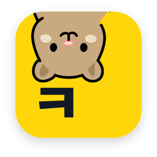
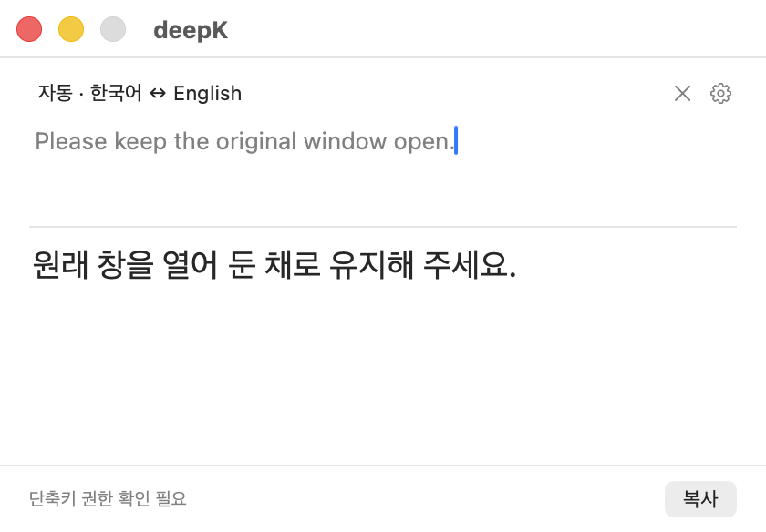

<p align="center">
  
</p>

<h1 align="center">deepK</h1>
<p align="center"><a href="README.md">한국어</a> · <b>English</b></p>
<p align="center"><b>A Mac menu bar app for text and image translation, using the AI subscription you already have. Select text and press ⌘C twice.</b></p>

<p align="center">
  <a href="https://github.com/Geuni620/deepK/releases/latest"></a>
  
  
</p>

<p align="center"><a href="https://deepk.geuni.me/en/">Official website ↗</a></p>

```sh
brew install --cask Geuni620/tap/deepk
```

Select text in any app and press **⌘C twice** to open the translation window. When the copied data includes image information, text and images are imported into the same window. Text translations can be copied or explicitly inserted back where you were typing. deepK translates between Korean and English through Codex CLI signed in with ChatGPT, or Claude Code signed in with a Claude subscription. See [Text and image translation](#text-and-image-translation) for image workflows.



## Install

Requires an Apple silicon Mac running macOS 15 or later. There is no Intel build yet.

**Homebrew**

```sh
brew install --cask Geuni620/tap/deepk
```

**Direct download**

Download `deepK-distribution-*.zip` from the [latest release](https://github.com/Geuni620/deepK/releases/latest), unzip it, and move `deepK.app` to your Applications folder. The app is signed with a Developer ID and notarized by Apple. Each release includes a `.sha256` file you can use to verify the download.

```sh
shasum -a 256 deepK-distribution-*.zip
```

After installing, install [Codex CLI](docs/development.md#codex-cli-준비) or [Claude Code](docs/development.md#claude-code-준비) for translation, sign in with your subscription account on this Mac, and follow [First run](#first-run). Your provider's subscription terms and usage limits still apply.

**Update and uninstall**

- Homebrew: quit the app, then run `brew update && brew upgrade --cask Geuni620/tap/deepk`
- Direct download: replace the app from the new release. Starting with 0.1.1 the app is named `deepK.app`; do not run it alongside the older `DeepK.app`.
- Uninstall: `brew uninstall --cask Geuni620/tap/deepk`, or delete `deepK.app` (formerly `DeepK.app`) from Applications

## Status

The current release is [v0.2.0](https://github.com/Geuni620/deepK/releases/tag/v0.2.0), and deepK is in an early release stage. Translation speed depends on the provider, model, and input.

- Text input with automatic translation, automatic or manual language direction
- Selected text and images in the same window; on-device OCR sends only text to the chosen provider
- Small inline icons stay small; image failures do not block selected-text translation or copy
- Capture a screen region you choose once, or read the same region again
- Inspect recognized text and translations, adjust reading size, and copy the image result as PNG
- Results that keep code blocks, inline code, and links, with copy
- Continued translation of paragraphs separated by a divider (`---`)
- Lives in the menu bar, returns to the original app, and inserts only when you ask

## First run

deepK lives in the menu bar. Launching it does not add a Dock icon; it adds an icon to the menu bar at the top right of the screen. On first launch, if the shortcut permission is not ready yet, the Settings window opens once.

1. Open deepK from Applications, or run `open /Applications/deepK.app` in Terminal, then find the deepK icon in the menu bar.
2. Open Settings from the menu bar, choose Codex or Claude Code, and check the connection.
3. In Settings → General → Permissions, click “설정 열기…” (Open Settings…) for Input Monitoring. Drag the deepK icon from the guide window that opens into the System Settings list and turn on the switch. Allow Accessibility, which is needed to insert back into the original app, the same way.
4. Select text in another app and press ⌘C twice. You can also type text directly.
5. Review the translation, then copy or insert it. Quit from the menu or with ⌘Q.

Double-copy translation is on by default in a new install and can be turned off in Settings. If monitoring is still not connected after you allow the permission, use “감시 다시 연결” (Reconnect monitoring) or “앱 다시 열기…” (Reopen app…) under Settings → General → Permissions. Source builds appear as `deepK Dev`, with macOS permissions and app preferences separate from the installed deepK.

Permissions apply to different actions:

| Permission | Used for |
| --- | --- |
| Input Monitoring | Detecting ⌘C twice in another app |
| Accessibility | Inserting a text translation back into the original input |
| Screen Recording | Capturing and reading a screen region you choose |

When screen capture requests it, use “화면 기록 허용” (Allow Screen Recording) and follow macOS instructions. Reading an image already on the clipboard and capturing the screen are separate input paths.

“Screen Recording” is the macOS permission needed to take one screenshot of the rectangle you select to read text in images or games that cannot be copied. deepK does not record video or continuously watch your screen. Ordinary text and clipboard images do not need this permission. OCR runs on your Mac; only recognized text goes to your chosen provider.

**If nothing appears after launch**

- With many menu bar icons, the deepK icon can be hidden behind the notch or other icons. Hide or rearrange some menu bar icons and look again.
- If the older `DeepK.app` from a previous release is still installed, do not run it alongside the new `deepK.app`. Check which app is running with `pgrep -ifl deepk`, quit the old one from its menu, then delete it.
- If System Settings lists more than one deepK, turn on permissions for `/Applications/deepK.app`, the one you actually use. The development app appears separately as `deepK Dev`.

## Text and image translation

Image translation uses the **existing deepK translation window**.

1. Select text and images on a web page, then press ⌘C twice. If the browser includes image information in the copied data, it is imported without another paste step. This path uses copied HTML from Chromium browsers such as Chrome.
2. Review the source and result in the same window. The Mac recognizes the image's text, and your selected Codex or Claude CLI translates it. Unreadable images do not prevent processing the available text and other images.
3. If an image is left out of the copy or the screen cannot be copied, click the screen-region icon at the top of the translation window (tooltip: “화면에서 이미지 가져오기”, Import image from screen) and drag a rectangle. Releasing the drag captures it once; Esc cancels. Use “다시 읽기” (Read again) when content changes in the same location.

You can also use ⌘V in the deepK translation window when an image is already on the clipboard.

| Control | Purpose |
| --- | --- |
| 인식한 글자 (Recognized text) | Inspect the source text read by OCR |
| 번역문 (Translation text) | Read received translations, including regions not applied to the image |
| 읽기 크기 / 화면 맞춤 / −/+ | Adjust the image's display size |
| 글 복사 (Copy text) | Copy the translated selected body text |
| 이미지 복사 (Copy image) | Copy the current image result as PNG after processing finishes |
| 다시 번역 (Translate again) | Retry translation with the current input |

Insertion back into the original input is available for ordinary text translation. Mixed text/image input uses Copy text or Copy image to take the result elsewhere.

**Limits**

- If a site omits image information from the copied data, selection alone cannot recover the missing image. Automatic fetching is limited to supported public image URLs; images requiring login or cookies may be unavailable.
- Small text, decorative fonts, and complex backgrounds affect recognition and rendering. If deepK reports that some regions kept their originals, use Translation text to inspect the result. Enlarge the source screen or select smaller regions when text is hard to recognize.
- OCR is configured for English and Korean. Screen capture runs once when you choose a region or press Read again; it does not continuously watch the screen. Not every game or full-screen environment has been verified.

## What is sent, and security limits

deepK sends translation instructions, text you type or copy, and text recognized in images to the provider you selected. It does not add original image files, their file paths, or image metadata to translation requests. OCR and background restoration run on the Mac; web images are fetched from their original image servers. deepK uses the official CLI you signed in to and never switches automatically to another provider or to API-key billing. Credentials, local environment files, and signing keys are not part of this repository.

deepK provides no feature for its operator to collect, store, or view your source text, images, recognized text, or translations. User content is excluded from analytics and automatic diagnostic reports, and no translation history is sent to the operator. The AI provider's handling and retention follow your account and that service's policies.

The official website uses GA4 only with a visitor's permission to count visits, install-guide interactions, and download clicks. The Mac app does not send translation content or usage to this analytics tool. See the [website privacy notice](https://deepk.geuni.me/en/privacy/#website-analytics) and [measurement scope](landing/docs/measurement.md).

- **Codex global instructions:** if `~/.codex/AGENTS.md` exists, its contents are included in requests. Do not put company secrets or tokens in that file. Project instructions and skill blocking do not remove this global file.
- **Sensitive copies:** copies that a password manager marks as concealed or transient are rejected. Copies that are marked late or not marked at all, and text pasted directly into the source field, are not protected. This clipboard-marker check also does not apply to regions you select on screen. Testing against specific password managers is still pending.
- **Text translation cache:** successful ordinary text translations are kept in memory for up to 32 entries and 5 minutes, and cleared when the app restarts. Image input and results are memory state used to process and display the current input; the app itself has no feature that automatically saves user content to files.
- **Test coverage:** offline tests and synthetic request checks are kept separate from checks with real accounts, apps, and permissions. This is not a complete real-world security audit.

See the [development guide](docs/development.md#보내는-내용과-실행-환경) for which environment variables are passed through, and the [security review notes](plans/public-release-security.md) for known limits. Do not post source text, tokens, or credential files in public issues or logs. Detailed documents are written in Korean.

## Build from source

Requires macOS 15 or later, full Xcode, and Swift 6. The tested environment is Xcode 26.1.1 / Swift 6.2.1. Install the CLI for your provider separately and sign in with your subscription account on the same Mac.

```sh
git clone https://github.com/Geuni620/deepK.git
cd deepK
./scripts/build-and-run.sh
```

The script quits only a running `deepK Dev`, then builds, signs, and launches the development app. It leaves the installed deepK running. An open translation in the development app is not preserved. To build only, use `./scripts/build.sh`.

- [Set up Codex CLI](docs/development.md#codex-cli-준비)
- [Set up Claude Code](docs/development.md#claude-code-준비): the app's install script needs Node.js and npm.
- To update later: `git pull --ff-only`, then `./scripts/build-and-run.sh`

Image background restoration can use a local model included in the app bundle. Development builds without that model may keep regions they cannot restore as original. See the [distribution guide](docs/distribution.md) for bundling and the [image model notices](experiments/image-translation/THIRD-PARTY-NOTICES.md) for provenance and separate notices.

A source ZIP without Git history must set `DEEPK_BUILD_NUMBER` when building. See the [development guide](docs/development.md#새-git-이력의-빌드-번호) for build numbers under the new Git history and what to watch for when replacing an existing install.

## Repository layout

```text
deepK/
├── DeepK/                 # Mac app source and resources
├── DeepKTests/            # App tests and synthetic fixtures
├── DeepK.xcodeproj/       # Xcode project
├── scripts/              # Build, test, and packaging tools
├── docs/                 # Development and distribution guides, test material
├── plans/                # App plans and earlier notes
├── benchmarks/           # Measurement samples and results
└── landing/              # Astro landing page and plans
```

Installers are published in this repository's [GitHub Releases](https://github.com/Geuni620/deepK/releases), and the Homebrew cask lives in [Geuni620/homebrew-tap](https://github.com/Geuni620/homebrew-tap). See the [landing guide](landing/README.md) to run and test the landing page.

## Development and testing

```sh
./scripts/test.sh
./scripts/build.sh
node --test scripts/fixture-server.test.mjs
python3 scripts/test-app-bundle-contents.py
```

The test tools need `rg` and Python 3. The development fixture server checks also use Node.js. `test.sh` covers logic, fake transport, and offscreen rendering, and never calls a real subscription. Checks that use real accounts or the GUI require separate, explicit options.

- [Development details and test commands](docs/development.md)
- [Preparing and distributing installers](docs/distribution.md)
- [Per-app real-world check notes](plans/mac-integration-checks.md)
- [Landing page docs](landing/README.md)

This repository starts from the current source with a new Git history. PR numbers and commit references in older development documents belong to the earlier private history.

## License

Original deepK code and documentation are provided under the [MIT License](LICENSE). Images, design material, and third-party text, data, and dependencies are separate; see the [license scope](docs/licensing.md#english).

## Third-party data

The Hanja reading table includes Unicode Unihan data. The full Unicode License v3 text is kept in the [third-party notices](THIRD-PARTY-NOTICES.txt) and the [data source](DeepK/Translation/HanjaReadingData.swift).

## Bug and security reports

Use [GitHub Issues](https://github.com/Geuni620/deepK/issues) for ordinary bugs and feature requests, and [private vulnerability reporting](https://github.com/Geuni620/deepK/security/advisories/new) for security vulnerabilities. Do not post vulnerability details, real source text, tokens, or login files in public issues. See the [security policy](SECURITY.md#private-vulnerability-reports) for report details and support scope.
