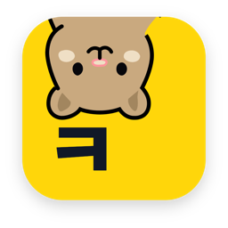
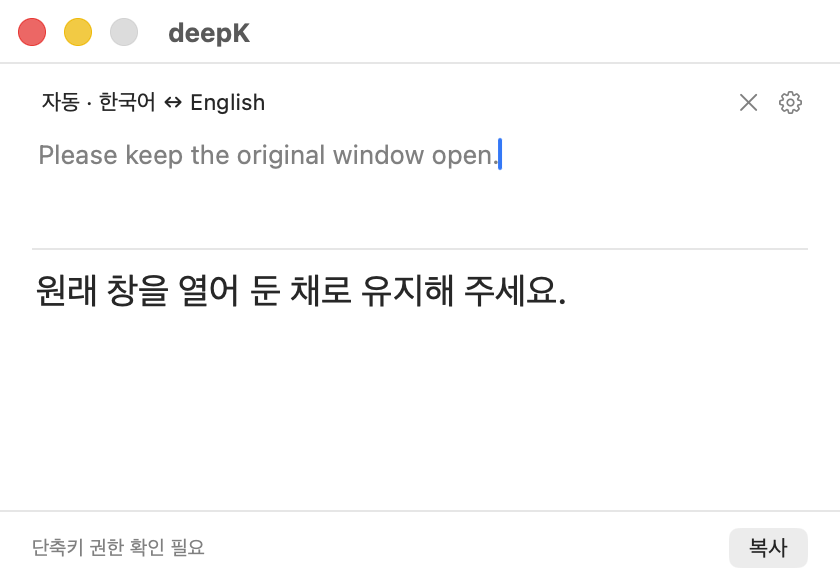

<p align="center">
  
</p>

<h1 align="center">deepK</h1>
<p align="center"><b>한국어</b> · <a href="README.en.md">English</a></p>
<p align="center"><b>읽던 글은 ⌘C 두 번. 글과 이미지를 같은 창에서, 쓰던 AI 구독으로 번역하는 Mac 메뉴 막대 앱입니다.</b></p>

<p align="center">
  <a href="https://github.com/Geuni620/deepK/releases/latest"></a>
  
  
</p>

<p align="center"><a href="https://deepk.geuni.me/">공식 웹사이트 ↗</a></p>

```sh
brew install --cask Geuni620/tap/deepk
```

다른 앱에서 텍스트를 선택하고 **⌘C를 두 번** 누르면 번역 창이 열립니다. 복사 데이터에 이미지 정보가 포함되면 글과 이미지도 같은 창으로 가져옵니다. 글 번역문은 복사하거나 원래 입력 위치에 명시적으로 삽입할 수 있습니다. ChatGPT로 로그인한 Codex CLI 또는 Claude 구독으로 로그인한 Claude Code를 사용해 한국어와 영어를 번역합니다. [이미지 사용법](#글과-이미지-번역)도 확인하세요.



## 설치

Apple Silicon Mac과 macOS 15 이상이 필요합니다. Intel Mac용 파일은 아직 제공하지 않습니다.

**Homebrew**

```sh
brew install --cask Geuni620/tap/deepk
```

**직접 내려받기**

[최신 릴리스](https://github.com/Geuni620/deepK/releases/latest)에서 `deepK-distribution-*.zip`을 내려받아 압축을 풀고 `deepK.app`을 응용 프로그램 폴더로 옮깁니다. Developer ID로 서명하고 Apple 공증을 받은 앱입니다. 함께 올린 `.sha256` 파일로 내려받은 파일을 확인할 수 있습니다.

```sh
shasum -a 256 deepK-distribution-*.zip
```

설치 후 번역에 사용할 [Codex CLI](docs/development.md#codex-cli-준비) 또는 [Claude Code](docs/development.md#claude-code-준비)를 설치하고, 이 Mac에서 구독 계정으로 로그인한 뒤 [처음 사용할 때](#처음-사용할-때)를 따릅니다. 제공자의 구독 조건과 사용량 제한은 별도로 적용됩니다.

**업데이트와 삭제**

- Homebrew: 앱을 종료한 뒤 `brew update && brew upgrade --cask Geuni620/tap/deepk`
- 직접 내려받기: 새 릴리스의 앱으로 교체. 0.1.1부터 배포 이름은 `deepK.app`이며, 이전 릴리스의 `DeepK.app`과 중복으로 실행하지 않습니다.
- 삭제: `brew uninstall --cask Geuni620/tap/deepk` 또는 응용 프로그램 폴더에서 `deepK.app`(이전 릴리스는 `DeepK.app`) 삭제

## 현재 상태

현재 정식 배포는 [v0.2.0](https://github.com/Geuni620/deepK/releases/tag/v0.2.0)이며 초기 배포 단계의 앱입니다. 번역 속도는 제공자·모델·입력에 따라 달라집니다.

- 원문 입력과 자동 번역, 자동·수동 언어 방향 선택
- 선택한 글·이미지를 같은 창에 가져오기, Mac에서 OCR 후 선택한 제공자에게 글자만 전달
- 작은 인라인 아이콘 유지, 이미지별 부분 실패 안내와 글 번역·복사 보호
- 직접 고른 화면 영역을 한 번 읽기, 같은 영역 다시 읽기
- 인식한 글자·번역문 확인, 읽기 크기 조절, 이미지 결과를 PNG로 복사
- 코드 블록·인라인 코드·링크를 유지하는 결과 표시와 복사
- 구분선(`---`)으로 나눈 문단의 이어서 번역
- 메뉴 막대 상주, 원래 앱 복귀와 명시적 삽입

## 처음 사용할 때

deepK는 메뉴 막대에 상주하는 앱입니다. 실행해도 Dock 아이콘은 나타나지 않고, 화면 오른쪽 위 메뉴 막대에 아이콘이 추가됩니다. 처음 실행했을 때 단축키 권한이 준비되지 않았으면 설정 창이 한 번 열립니다.

1. 응용 프로그램 폴더에서 deepK를 열거나 터미널에서 `open /Applications/deepK.app`을 실행한 뒤, 메뉴 막대의 deepK 아이콘을 찾습니다.
2. 메뉴 막대에서 설정을 열고 Codex 또는 Claude Code를 선택한 뒤 연결을 확인합니다.
3. 설정 → 일반 → 권한에서 입력 모니터링의 ‘설정 열기…’를 누릅니다. 함께 열리는 안내 창의 deepK 아이콘을 시스템 설정 목록으로 끌어다 놓고 스위치를 켭니다. 원래 위치 삽입에 필요한 손쉬운 사용 권한도 같은 방법으로 허용합니다.
4. 다른 앱에서 텍스트를 선택하고 ⌘C를 두 번 누릅니다. 직접 입력으로도 번역할 수 있습니다.
5. 번역문을 확인한 뒤 복사하거나 삽입합니다. 앱 종료는 메뉴의 종료 또는 ⌘Q입니다.

새 설치에서는 두 번 복사 자동 번역이 켜져 있습니다. 설정에서 끌 수 있습니다. 권한을 허용한 뒤에도 입력 감시가 연결되지 않으면 설정 → 일반 → 권한의 ‘감시 다시 연결’이나 ‘앱 다시 열기…’를 사용합니다. 소스에서 실행하는 개발 앱은 `deepK Dev`로 표시되며, 설치된 deepK와 권한·앱 설정이 분리됩니다.

권한은 동작별로 다릅니다.

| 권한 | 필요한 동작 |
| --- | --- |
| 입력 모니터링 | 다른 앱에서 누르는 ⌘C 두 번 감지 |
| 손쉬운 사용 | 글 번역문을 원래 입력 위치에 삽입 |
| 화면 기록 | 직접 지정한 화면 영역 캡처와 다시 읽기 |

화면 영역을 가져올 때 표시되는 ‘화면 기록 허용’을 눌러 macOS 안내에 따라 설정합니다. 클립보드에 이미 들어 있는 이미지를 읽는 것과 화면을 캡처하는 것은 별도 경로입니다.

**실행해도 아무것도 보이지 않을 때**

- 메뉴 막대 아이콘이 많으면 deepK 아이콘이 노치나 다른 아이콘 뒤로 가려질 수 있습니다. 메뉴 막대 아이콘 일부를 숨기거나 정리한 뒤 다시 확인합니다.
- 이전 릴리스의 `DeepK.app`이 남아 있으면 새 `deepK.app`과 함께 실행하지 않습니다. `pgrep -ifl deepk`로 실행 중인 앱 경로를 확인하고, 이전 앱을 메뉴의 종료로 끈 뒤 삭제합니다.
- 시스템 설정 목록에 deepK가 둘 이상 보이면 실제로 사용하는 `/Applications/deepK.app`의 권한을 켭니다. 개발 앱은 `deepK Dev`로 따로 표시됩니다.

## 글과 이미지 번역

이미지 번역도 **기존 deepK 번역창**에서 처리합니다.

1. 웹페이지에서 글과 이미지를 함께 선택하고 ⌘C를 두 번 누릅니다. 브라우저가 이미지 정보를 복사 데이터에 포함했다면 별도 붙여넣기 없이 가져옵니다. 이 경로는 Chrome 등 Chromium 계열의 복사 HTML을 사용합니다.
2. 같은 창에서 원문과 번역 결과를 확인합니다. 이미지는 이 Mac에서 글자를 읽고, 선택한 Codex 또는 Claude CLI가 인식한 글자를 번역합니다. 불러오지 못한 이미지가 있어도 읽을 수 있는 글과 다른 이미지는 계속 처리합니다.
3. 이미지가 선택·복사에서 빠지거나 복사할 수 없는 화면이면, 번역창 상단의 화면 영역 아이콘(도움말: ‘화면에서 이미지 가져오기’)을 누르고 범위를 드래그합니다. 드래그를 놓으면 한 번 캡처하며 Esc로 취소합니다. 같은 위치의 내용이 바뀌면 ‘다시 읽기’를 누릅니다.

이미 이미지가 클립보드에 있다면 deepK 번역창에서 ⌘V로 가져올 수도 있습니다.

| 화면의 기능 | 용도 |
| --- | --- |
| 인식한 글자 | OCR이 읽은 원문을 확인 |
| 번역문 | 이미지에 반영되지 않은 영역까지 받은 번역을 글로 확인 |
| 읽기 크기·화면 맞춤·−/+ | 이미지 표시 크기 조절 |
| 글 복사 | 선택한 본문의 번역을 텍스트로 복사 |
| 이미지 복사 | 처리가 끝난 뒤 현재 이미지 결과를 PNG로 복사 |
| 다시 번역 | 현재 입력으로 번역 재시도 |

원래 입력 위치로 삽입하는 기능은 일반 글 번역에서 사용합니다. 글·이미지 혼합 입력은 ‘글 복사’ 또는 ‘이미지 복사’로 결과를 가져갑니다.

**알아둘 한계**

- 웹사이트가 복사 데이터에 이미지 정보를 넣지 않으면 선택만으로 빠진 이미지를 복원할 수 없습니다. 자동 불러오기는 지원하는 공개 이미지 주소로 제한되며 로그인·쿠키가 필요한 이미지는 읽지 못할 수 있습니다.
- 작은 글씨·장식 글꼴·복잡한 배경에서는 인식과 합성 품질이 달라집니다. 일부 영역을 원본으로 유지했다는 안내가 나오면 ‘번역문’을 확인하세요. 작은 글자가 잘 읽히지 않으면 원본 화면을 확대하거나 영역을 나눠 다시 읽습니다.
- OCR은 영어·한국어를 대상으로 구성되어 있습니다. 화면 스캔은 사용자가 선택하거나 ‘다시 읽기’를 누를 때 한 번씩 실행하며 화면을 계속 감시하지 않습니다. 모든 게임·전체 화면 환경에서 동작을 검증한 것은 아닙니다.

## 보내는 정보와 보안 한계

번역 지시와 직접 입력·복사한 글, 이미지에서 인식한 글자를 선택한 제공자에게 보냅니다. 이미지의 원본 파일·파일 경로·메타데이터를 번역 요청에 추가하지 않습니다. 이미지 OCR과 배경 복원은 Mac에서 처리하며, 웹 이미지는 원본 이미지 서버에서 불러옵니다. deepK는 사용자가 로그인한 공식 CLI를 이용하며 다른 제공자나 API 키 과금으로 자동 전환하지 않습니다. 인증정보·로컬 환경 파일·서명 키는 저장소에 포함하지 않습니다.

deepK 운영자가 사용자의 원문·이미지·인식한 글자·번역문을 수집하거나 저장해 열람하는 기능은 제공하지 않습니다. 사용자 콘텐츠를 분석 수집이나 자동 진단 보고서에 포함하지 않으며, 운영자에게 보내는 번역 기록도 만들지 않습니다. 선택한 AI 제공자의 정보 처리·보관 조건은 사용하는 계정과 서비스 정책을 따릅니다.

- **Codex 전역 지침:** `~/.codex/AGENTS.md`가 있으면 그 내용도 요청에 포함됩니다. 회사 기밀·토큰을 전역 지침에 넣지 마세요. 프로젝트 지침과 설치된 스킬 차단은 이 전역 파일을 제거하지 않습니다.
- **민감한 복사:** 비밀번호 관리자가 숨김·임시 표시를 붙인 복사는 거절합니다. 표시가 늦게 붙거나 표시가 없는 복사, 원문 창에 직접 붙여넣은 내용까지 보호하지는 못합니다. 화면에서 직접 고르는 영역에도 이 클립보드 표시 검사가 적용되는 것은 아닙니다. 실제 비밀번호 관리자별 검증은 남아 있습니다.
- **글 번역 캐시:** 일반 글 번역의 성공한 결과를 메모리에 최대 32개·5분간 보관하며 앱 재시작 시 비워집니다. 이미지 입력과 결과는 현재 화면을 처리·표시하는 메모리 상태로 관리하며, 앱 자체에 사용자 콘텐츠를 자동으로 파일 저장하는 기능은 없습니다.
- **검증 범위:** 오프라인 테스트·합성 요청 검증과 실제 계정·앱·권한 검증을 구분합니다. 전체 실환경 보안 검증 완료를 뜻하지 않습니다.

환경 변수 전달 범위는 [개발 안내](docs/development.md#보내는-내용과-실행-환경), 알려진 한계는 [보안 점검 기록](plans/public-release-security.md)을 참고하세요. 원문·토큰·인증 파일을 공개 이슈나 로그에 올리지 마세요.

## 소스에서 실행

macOS 15 이상, 전체 Xcode와 Swift 6가 필요합니다. 기존 검증 환경은 Xcode 26.1.1 / Swift 6.2.1입니다. 사용할 제공자의 CLI를 별도로 설치하고 해당 Mac에서 구독 계정으로 로그인해야 합니다.

```sh
git clone https://github.com/Geuni620/deepK.git
cd deepK
./scripts/build-and-run.sh
```

이 스크립트는 실행 중인 `deepK Dev`만 종료한 뒤 개발 앱을 빌드·서명·실행합니다. 설치된 deepK는 계속 실행됩니다. 개발 앱에 열려 있던 번역창 내용은 유지되지 않습니다. 빌드만 하려면 `./scripts/build.sh`를 사용합니다.

- [Codex CLI 준비](docs/development.md#codex-cli-준비)
- [Claude Code 준비](docs/development.md#claude-code-준비): 앱 전용 설치 스크립트에는 Node.js와 npm이 필요합니다.
- 이후 업데이트: `git pull --ff-only` 후 `./scripts/build-and-run.sh`

이미지 배경 복원은 앱 번들에 포함된 로컬 모델을 사용할 수 있습니다. 모델이 없는 개발 빌드에서는 복원할 수 없는 영역을 원본으로 유지할 수 있습니다. 모델 포함 배포 절차는 [배포 안내](docs/distribution.md), 출처와 별도 고지는 [이미지 모델 고지](experiments/image-translation/THIRD-PARTY-NOTICES.md)를 참고하세요.

Git 이력이 없는 소스 ZIP은 빌드 시 `DEEPK_BUILD_NUMBER`를 명시해야 합니다. 새 Git 이력의 빌드 번호와 기존 설치에 배포할 때의 주의점은 [개발 안내](docs/development.md#새-git-이력의-빌드-번호)를 참고하세요.

## 저장소 구조

```text
deepK/
├── DeepK/                 # Mac 앱 소스와 리소스
├── DeepKTests/            # 앱 테스트와 합성 fixture
├── DeepK.xcodeproj/       # Xcode 프로젝트
├── scripts/              # 빌드·검증·패키징 도구
├── docs/                 # 개발·배포 안내와 검증 자료
├── plans/                # 앱 개발 계획과 이전 기록
├── benchmarks/           # 측정 표본과 기록
└── landing/              # Astro 랜딩페이지와 계획
```

설치 파일은 이 저장소의 [GitHub Releases](https://github.com/Geuni620/deepK/releases)에서, Homebrew 설치 정보는 [Geuni620/homebrew-tap](https://github.com/Geuni620/homebrew-tap)에서 배포합니다. 랜딩페이지의 실행·검증 방법은 [랜딩 안내](landing/README.md)를 참고하세요.

## 개발과 검증

```sh
./scripts/test.sh
./scripts/build.sh
node --test scripts/fixture-server.test.mjs
python3 scripts/test-app-bundle-contents.py
```

테스트 도구에는 `rg`와 Python 3가 필요합니다. 개발용 fixture 서버 검증에는 Node.js도 사용합니다. `test.sh`는 로직·가짜 통신·화면 밖 렌더링을 검사하며 실제 구독을 호출하지 않습니다. 실제 계정·GUI를 사용하는 검증은 별도의 명시적 실행 옵션이 필요합니다.

- [개발 상세와 검증 명령](docs/development.md)
- [설치 파일 준비와 배포](docs/distribution.md)
- [앱별 실환경 검증 기록](plans/mac-integration-checks.md)
- [랜딩페이지 문서](landing/README.md)

이 저장소는 현재 소스에서 새 Git 이력으로 시작합니다. 과거 개발 문서의 PR 번호와 커밋 참조는 이전 비공개 개발 기록에 속합니다.

## 라이선스

deepK 자체 코드와 문서는 [MIT License](LICENSE)를 따릅니다. 이미지·디자인 자료와 제3자 원문·데이터·의존성은 별도이며, 자세한 범위는 [라이선스 안내](docs/licensing.md)를 참고하세요.

## 제3자 데이터

한자 독음 표에는 Unicode Unihan 데이터가 포함되어 있습니다. Unicode License v3 전문은 [제3자 고지](THIRD-PARTY-NOTICES.txt)와 [데이터 소스](DeepK/Translation/HanjaReadingData.swift)에 유지합니다.

## 문제·보안 제보

일반 오류·기능 제안은 [GitHub Issues](https://github.com/Geuni620/deepK/issues), 보안 취약점은 [비공개 취약점 제보](https://github.com/Geuni620/deepK/security/advisories/new)로 보내주세요. 취약점 세부 내용이나 실제 원문·토큰·로그인 파일을 공개 이슈에 올리지 마세요. 제보에 필요한 정보와 대응 범위는 [보안 정책](SECURITY.md)에 있습니다.
