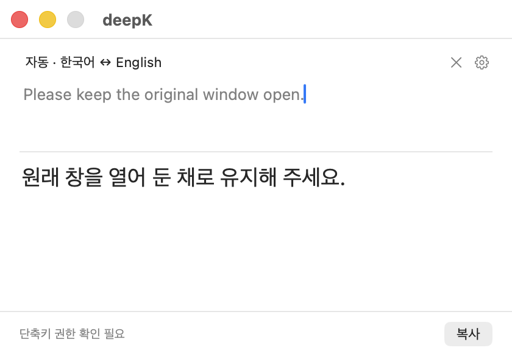

# deepK

읽거나 쓰던 흐름을 유지하면서 한국어와 영어를 번역하는 macOS 메뉴 막대 앱입니다.

다른 앱에서 텍스트를 선택하고 **⌘C를 두 번** 누르면 번역 창이 열립니다. 번역문을 복사하거나 원래 입력 위치에 명시적으로 삽입할 수 있습니다. ChatGPT로 로그인한 Codex CLI 또는 Claude 구독으로 로그인한 Claude Code를 사용합니다.



## 현재 상태

개발 중인 개인용 앱입니다. 소스에서 빌드해 사용할 수 있으며, 공증된 설치 파일은 아직 제공하지 않습니다. 번역 속도는 제공자·모델·입력에 따라 달라집니다.

- 원문 입력과 자동 번역, 자동·수동 언어 방향 선택
- 코드 블록·인라인 코드·링크를 유지하는 결과 표시와 복사
- 구분선(`---`)으로 나눈 문단의 이어서 번역
- 메뉴 막대 상주, 원래 앱 복귀와 명시적 삽입
- 같은 저장소의 `landing/`에서 관리하는 랜딩페이지 문서

## 소스에서 실행

macOS 15 이상, 전체 Xcode와 Swift 6가 필요합니다. 기존 검증 환경은 Xcode 26.1.1 / Swift 6.2.1입니다. 사용할 제공자의 CLI를 별도로 설치하고 해당 Mac에서 구독 계정으로 로그인해야 합니다.

```sh
git clone https://github.com/Geuni620/deepK.git
cd deepK
./scripts/build-and-run.sh
```

이 스크립트는 실행 중인 deepK를 종료한 뒤 빌드·서명·실행합니다. 열려 있던 번역창 내용은 유지되지 않습니다. 빌드만 하려면 `./scripts/build.sh`를 사용합니다.

- [Codex CLI 준비](docs/development.md#codex-cli-준비)
- [Claude Code 준비](docs/development.md#claude-code-준비): 앱 전용 설치 스크립트에는 Node.js와 npm이 필요합니다.
- 이후 업데이트: `git pull --ff-only` 후 `./scripts/build-and-run.sh`

Git 이력이 없는 소스 ZIP은 빌드 시 `DEEPK_BUILD_NUMBER`를 명시해야 합니다. 새 Git 이력의 빌드 번호와 기존 설치에 배포할 때의 주의점은 [개발 안내](docs/development.md#새-git-이력의-빌드-번호)를 참고하세요.

## 처음 사용할 때

1. 메뉴 막대에서 설정을 열고 Codex 또는 Claude Code를 선택한 뒤 연결을 확인합니다.
2. macOS 시스템 설정에서 입력 모니터링을 허용합니다. 원래 위치 삽입에는 손쉬운 사용 권한도 필요합니다.
3. 다른 앱에서 텍스트를 선택하고 ⌘C를 두 번 누릅니다. 직접 입력으로도 번역할 수 있습니다.
4. 번역문을 확인한 뒤 복사하거나 삽입합니다. 앱 종료는 메뉴의 종료 또는 ⌘Q입니다.

새 설치에서는 두 번 복사 자동 번역이 켜져 있습니다. 설정에서 끌 수 있습니다. 새 checkout이나 서명 방식으로 앱 경로가 바뀌면 macOS 권한을 다시 등록해야 할 수 있습니다.

## 보내는 정보와 보안 한계

번역 지시와 원문을 선택한 제공자에게 보냅니다. deepK는 사용자가 로그인한 공식 CLI를 이용하며 다른 제공자나 API 키 과금으로 자동 전환하지 않습니다. 인증정보·로컬 환경 파일·서명 키는 저장소에 포함하지 않습니다.

- **Codex 전역 지침:** `~/.codex/AGENTS.md`가 있으면 그 내용도 요청에 포함됩니다. 회사 기밀·토큰을 전역 지침에 넣지 마세요. 프로젝트 지침과 설치된 스킬 차단은 이 전역 파일을 제거하지 않습니다.
- **민감한 복사:** 비밀번호 관리자가 숨김·임시 표시를 붙인 복사는 거절합니다. 표시가 늦게 붙거나 표시가 없는 복사, 원문 창에 직접 붙여넣은 내용까지 보호하지는 못합니다. 실제 비밀번호 관리자별 검증은 남아 있습니다.
- **번역 캐시:** 성공한 결과를 메모리에 최대 32개·5분간 보관하며 앱 재시작 시 비워집니다.
- **검증 범위:** 오프라인 테스트·합성 요청 검증과 실제 계정·앱·권한 검증을 구분합니다. 전체 실환경 보안 검증 완료를 뜻하지 않습니다.

환경 변수 전달 범위는 [개발 안내](docs/development.md#보내는-내용과-실행-환경), 알려진 한계는 [보안 점검 기록](plans/public-release-security.md)을 참고하세요. 원문·토큰·인증 파일을 공개 이슈나 로그에 올리지 마세요.

## 저장소 구조

```text
deepK/
├── DeepK/                 # Mac 앱 소스와 리소스
├── DeepKTests/            # 앱 테스트와 합성 fixture
├── DeepK.xcodeproj/       # Xcode 프로젝트
├── scripts/              # 빌드·검증·패키징 도구
├── docs/                 # 개발·배포 안내와 검증 자료
├── plans/                # 앱 개발 계획과 이전 기록
├── benchmarks/           # 측정 표본과 기록
└── landing/              # 랜딩페이지와 참고 계획
```

랜딩페이지는 현재 구조와 문서를 정리한 단계입니다. 콘텐츠·체험·API·모델·비용·배포 방식은 미정이며, 이전 초안을 현재 구현 결정으로 취급하지 않습니다. [랜딩 안내](landing/README.md)를 참고하세요.

## 개발과 검증

```sh
./scripts/test.sh
./scripts/build.sh
```

테스트 도구에는 `rg`와 Python 3가 필요합니다. `test.sh`는 로직·가짜 통신·화면 밖 렌더링을 검사하며 실제 구독을 호출하지 않습니다. 실제 계정·GUI를 사용하는 검증은 별도의 명시적 실행 옵션이 필요합니다.

- [개발 상세와 검증 명령](docs/development.md)
- [설치 파일 준비와 배포](docs/distribution.md)
- [앱별 실환경 검증 기록](plans/mac-integration-checks.md)
- [랜딩페이지 문서](landing/README.md)

이 저장소는 현재 소스에서 새 Git 이력으로 시작합니다. 과거 개발 문서의 PR 번호와 커밋 참조는 이전 비공개 개발 기록에 속합니다.

## 제3자 데이터

한자 독음 표에는 Unicode Unihan 데이터가 포함되어 있습니다. Unicode License v3 전문은 [데이터 소스](DeepK/Translation/HanjaReadingData.swift)와 [제3자 고지](docs/development.md#제3자-데이터)에 유지합니다. 프로젝트 전체의 재사용 라이선스는 별도로 정합니다.
