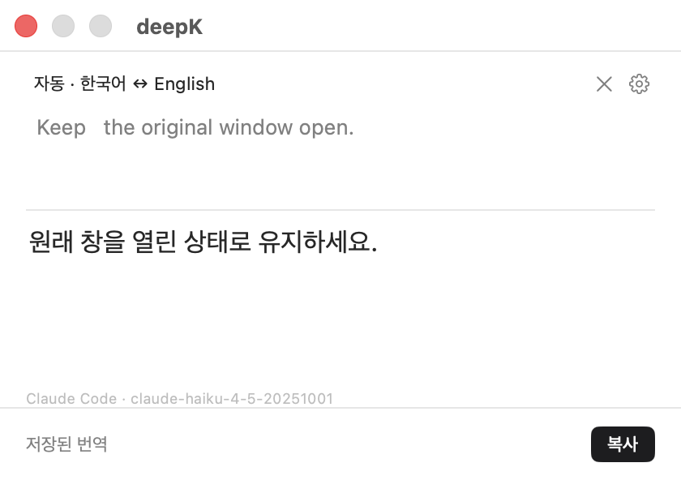

# 개발 상세와 구현 기록

이 문서는 초기 비공개 개발 단계의 사용법·구현·측정 기록을 보존한다. 현재 저장소의 시작점은 [루트 README](../README.md)다. 여기와 기존 계획에 등장하는 과거 PR 번호·커밋은 이전 개발 이력의 참조이며, 새 저장소의 PR 번호와 대응하지 않는다. 현재 실행 환경과 검증 범위를 확인한 뒤 참고한다.

읽거나 쓰던 흐름을 유지하면서 한국어와 영어를 빠르게 번역하는 개인용 앱.

## 저장소 구조

deepK 앱과 랜딩페이지를 같은 저장소에서 관리한다.

```text
deepK/
|-- DeepK/                 # Mac 앱 소스·리소스
|-- DeepKTests/            # Mac 앱 테스트
|-- DeepK.xcodeproj/       # Xcode 프로젝트
|-- scripts/               # Mac 앱 개발·검증·패키징
|-- docs/                  # 기존 앱 문서·검증 자료
|-- plans/                 # 기존 앱 개발 계획
|-- benchmarks/            # 앱 벤치마크 자료
|-- landing/               # 랜딩페이지 영역
|   |-- README.md          # 구조·현재 결정 상태
|   `-- plans/             # 이전 랜딩 검토 초안
|-- VERSION                # Mac 앱 버전
`-- README.md              # 저장소 안내
```

Mac 앱은 아래의 [개발과 실행](#개발과-실행)을 따른다. 랜딩페이지의 준비 상태와 참고 계획은 [랜딩 안내](../landing/README.md)에서 관리한다.

## 제품 방향

- macOS를 먼저 대상으로 하고, 이후 iPhone에서의 사용을 검토한다.
- Swift + SwiftUI를 중심으로, Mac 창과 포커스 제어에는 AppKit을 활용하는 방향이다. 기본 앱과 입력·결과 화면을 구현했다.
- 가장 중요한 요구사항은 **호출부터 번역문 전체 표시까지 대체로 1초 이내**다. 첫 토큰 표시만으로 완료를 판단하지 않는다.
- ChatGPT 구독의 Codex(Luna)와 Claude 구독의 Claude Code(기본 Haiku 5.5, Sonnet 5.5·Opus 5.5·Fable 5.1 선택 가능)를 지원한다. 설정에서 기본 제공자를 선택하며 다른 제공자나 유료 API로 자동 전환하지 않는다.
- 번역에는 지원되는 최소 추론 강도를 사용한다. Codex 번역은 기본으로 일반(default) 계층을 쓰며, 설정의 번역 탭에서 "Codex 빠른 응답(Fast)"을 켜면 Fast(priority) 계층을 쓴다. Fast는 생성이 빠른 대신 구독 사용량이 늘어난다. 번역 캐시는 계층을 구분하지 않으므로 토글 효과는 새 원문이나 '다시 번역'으로 확인한다.

## 현재 상태

Compact Stack 기반 SwiftUI 화면에 ChatGPT 구독 번역을 연결했다. 원문 입력 뒤 자동 번역, 자동/수동 언어 방향, 긴 문단의 독립 스크롤, 결과 복사, 로그인·연결 설정과 모델 선택을 제공한다. 메뉴 막대 상주, 두 번 복사 감지, 원래 앱 복귀와 명시적 삽입 코드를 추가했다.

확인한 범위: 실제 구독 번역과 결과 화면·복사, 번역 상태/취소/IME 테스트, 전용 창의 OS 이벤트 두 번 복사 검증, TextEdit 직접 삽입. 이번 복구에서 실제 deepK의 두 번 복사 → Luna 자동 번역을 합성 OS 입력으로 확인했고, 사용자가 실제 키보드로 창이 뜨는 것도 확인했다. 앱별 전체 삽입 검증 범위는 기록을 참고한다. Chrome textarea는 별도의 명시적 붙여넣기 경로에서 삽입·내용 재확인·클립보드 복원을 확인했다. [앱별 검증 기록](../plans/mac-integration-checks.md)을 참고한다.

최소 macOS 15, Swift 6. Xcode 26.1.1 / Swift 6.2.1에서 검증한다. 새 설치의 기본값은 Codex의 Luna다. 기존에 저장한 모델 선택은 보존하며 설정에서 변경할 수 있다. Claude Code의 기본값은 Haiku 5.5이며 설정에서 Sonnet 5.5·Opus 5.5·Fable 5.1을 고를 수 있다. 이전에 Haiku 4.5를 골랐다면 Haiku 5.5로 옮긴다([비교 결과](../benchmarks/haiku-45-vs-55-summary.md)). Codex는 연결한 계정의 모델 목록을 그대로 보여 준다. [30회 측정](../benchmarks/pilot-summary.md)은 약 4–10초였고 1초 이내는 없었다. 사용자 결정으로 구독은 유지하고 1초는 미달한 개선 목표로 남긴다.

## 개발과 실행

저장소를 처음 받은 Mac에서는 `git clone` 후 프로젝트 폴더로 이동한다. 이후 업데이트와 실행은 아래 두 명령으로 한다.

```sh
git pull --ff-only
./scripts/build-and-run.sh
```

스크립트는 macOS 15 이상·전체 Xcode·Swift 6 환경을 확인하고, 실행 중인 deepK Dev만 정상 종료한 뒤 빌드·서명·실행한다. 설치된 deepK는 유지한다. 개발 앱이 종료되지 않거나 빌드가 실패하면 중단한다. 기존 설정과 로그인은 삭제하지 않지만 개발 앱에 열려 있던 번역창 내용은 유지되지 않는다. 다른 폴더에서도 스크립트의 절대 경로로 실행할 수 있다. 같은 checkout 경로를 계속 사용하면 권한에 등록할 앱 경로도 유지된다.

다른 Mac에서는 사용할 Codex CLI 또는 Claude Code를 별도로 설치하고 해당 Mac에서 구독 로그인해야 한다. Claude 전용 설치는 아래 `setup-claude.sh`를 사용한다. 실행 파일이나 로그인 정보는 Git에 포함되지 않는다. 두 권한도 Mac마다 처음 허용해야 하며, 개발 인증서가 없으면 재빌드 후 권한 재등록이 필요할 수 있다. 이 스크립트는 소스에서 로컬 빌드하는 방식이며 공증된 배포 패키지를 만들지 않는다.

Codex CLI는 아래 [Codex CLI 준비](#codex-cli-준비)의 순서로 찾는다. Claude 준비 후 checkout 폴더를 옮겼다면 `./scripts/setup-claude.sh`를 다시 실행해 저장된 실행 경로를 갱신한다.

빌드만 하려면 `./scripts/build.sh`를 사용한다. 종료한 앱만 다시 열 때는 다음 명령으로 충분하다.

```sh
open ".build/DerivedData/Build/Products/Debug/deepK Dev.app"
```

Xcode에서는 `DeepK.xcodeproj`를 열고 `DeepK` scheme을 실행한다. 스크립트는 빌드 후 이 Mac의 Apple Development 인증서가 있으면 서명해 권한 식별자를 유지한다. DEEPK_SIGNING_IDENTITY로 인증서를 지정할 수도 있다. 인증서가 없으면 임시 서명 상태로 남고 재빌드 후 권한 재허용이 필요할 수 있다. 공개 배포·공증은 범위 밖이다.

준비된 앱은 실행 시 창을 띄우지 않고 메뉴 막대에서 대기한다. 처음 권한 설정이 필요할 때만 설정을 안내하며, 메뉴 막대에서도 감시 상태를 확인할 수 있다. 번역 창은 ⌘C 두 번 또는 메뉴의 열기로 표시한다. 번역 창에서 ⌘W를 누르면 창을 숨기고 앱은 계속 상주한다. 설정 창에서 ⌘W를 누르면 설정 창만 닫는다. 완전 종료는 메뉴의 종료 또는 ⌘Q를 사용한다. 수동 입력은 마지막 변경 후 500ms 대기하고, 조합 중·동일 입력 중복 알림은 요청하지 않는다. 단축키 호출은 타이핑 대기 없이 처리한다. 원문 창의 `---` 줄(줄 맨 앞의 `-` 3개 이상, 코드 펜스 밖)은 블록 경계다. 아래 블록은 위 블록을 다시 번역하지 않고 따로 번역하며, 결과 창은 `---` 대신 가는 선으로 나눈다. 복사·삽입은 블록을 빈 줄 하나로 잇고 `---`를 넣지 않는다. 원문 창에서도 경계로 인정된 줄은 마크다운 가로줄처럼 대시 없이 선 하나로 보인다. `---`를 치는 순간 선이 되고 커서는 그 아래 새 줄로 간다. 커서는 선 위에 서지 않고 건너뛰며, 선 바로 아래 줄 첫머리에서 ⌫를 누르면 선이 통째로 지워진다. 원문 글자는 그대로라 복사하면 `---`가 나온다. ⌘↩(편집 메뉴 ‘끝에 구분선 넣기’)는 번역 창을 클릭해 활성(key) 상태일 때 포커스가 결과 창에 있어도 원문 끝에 `---`와 빈 줄을 덧붙이고 커서를 그 아래에 둔다. ⌘C 두 번으로 띄운 번역 창은 앞에만 놓이고 포커스는 원래 앱에 남으므로, 먼저 번역 창을 클릭한다. 그대로 ⌘↩를 누르면 원래 앱이 받는다(메일 보내기·댓글 제출일 수 있다). 메뉴 막대가 보이지 않으므로 단축키로 쓴다. 원문에 내용이 없거나 닫히지 않은 ``` 펜스 안이면 동작하지 않는다. 규칙과 한계는 [명시 경계 번역](../plans/explicit-boundary-translation.md)에 있다.

## 처음 사용할 때

1. 메뉴 막대에서 deepK를 열고 설정에서 기본 제공자를 선택한다. Codex/Luna는 ChatGPT로 로그인한 Codex CLI를 사용한다. Claude Code는 아래 앱 전용 CLI 준비 후 Claude 구독 로그인을 사용한다. ‘연결 확인’으로 선택한 제공자의 상태를 확인하며 별도 API 키 과금으로 전환하지 않는다.
2. deepK Dev 설정의 권한 요청 버튼을 누르고 macOS 시스템 설정에서 입력 모니터링을 허용한다. 원래 위치 삽입에는 접근성도 필요하다. 목록에 없다면 시스템 설정의 추가 버튼으로 위 빌드 결과의 `deepK Dev.app`을 선택한다. macOS가 재실행을 요구하면 앱을 다시 연다.
3. 설정의 다시 확인을 누른다. 준비된 상태에서 다른 앱의 텍스트를 선택하고 ⌘C를 두 번 누르면 자동 번역한다. 한 번 복사는 그대로 동작한다.
4. 결과 복사는 클립보드에 번역문을 넣는다. 삽입은 지원하는 편집 가능한 원래 위치에서만 별도 클릭으로 실행한다. 실패한 경우 내용 변경을 확인하고 복사를 사용한다.

번역 창 아래에는 높이가 고정된 막대 하나만 있다. 왼쪽은 확인할 일이 있을 때만 한 줄을 보인다. 복사한 텍스트 확인 중, 오류·실패 안내, 입력 중…·번역 중…·연결 전 같은 끝나지 않은 상태, 단축키 감시 실패 안내, 제공자·모델을 바꾼 뒤의 다시 번역 안내, 단축키 감시가 연결되지 않은 상태 순이다. 누르면 전체 문구가 보인다. 평소에는 비어 있고, 마우스를 올리면 결과를 만든 제공자·모델과 걸린 시간(초)이 보인다. ‘완료’·‘저장된 번역’·‘⌘C 두 번 · 감지 중’과 설정에서 끈 ‘두 번 복사 꺼짐’은 따로 알리지 않는다. 오른쪽은 그때 필요한 동작(번역 제공자 연결 설정·다시 번역·다시 시도·↓ 새 번역 보기) 하나와 삽입·복사다. 복사하면 ‘복사’ 버튼이 2초쯤 ‘복사됨’으로 바뀌고, 삽입할 수 없는 이유는 복사 버튼의 툴팁에 있다. ‘전체 다시 번역’은 결과 글의 오른쪽 클릭 메뉴 맨 위에 있다. 결과가 아직 없을 때의 진행 상태와 오류는 결과가 나올 자리에 보인다.

번역 결과의 코드는 모델이 언어 태그를 붙인 ``` 펜스로 감싸고, 결과 창은 펜스 줄 없이 코드 카드로 보여 준다. 기본 스타일 macOS Native는 카드 머리줄에 언어 이름과 줄 수(`</> TypeScript · 12줄`)를, 오른쪽에 그 블록의 코드만 복사하는 ‘복사’를 둔다. 코드는 언어별 문법 색으로 칠하고, 5줄이 넘는 블록은 5줄만 보이고 아래 ‘12줄 모두 보기’(GitHub는 ‘7줄 더 보기’)로 펼친다. 접기는 화면에서만이고 복사·삽입에는 모든 줄이 들어간다. 설정의 ‘표시’ 탭에서 코드 스타일(macOS Native, GitHub: 테두리 카드·원래 언어 태그·아이콘 복사 버튼), 긴 코드 접기와 보일 줄 수(3·5·8·10·15·20), 링크 출처 표시, 문법 색을 바꾼다. ‘코드 스타일 ›’을 누르면 창이 넓어지며 실제 결과 창과 같은 미리보기가 열리고 ↑↓로 바로 바꾼다. 열린 결과 창에도 바로 반영된다. 끝에 남은 빈 펜스는 지우고 닫히지 않은 펜스는 닫는다(원문 선택이 펜스 안에서 끝난 경우는 그대로 둔다). 코드가 있는 결과는 설정의 ‘복사 형식’에 따라 서식(HTML·RTF)과 일반 텍스트를 함께 복사하거나(기본) ``` 펜스가 있는 마크다운으로 복사한다. 원문에 펜스가 없으면 일반 텍스트와 삽입에서는 펜스 줄을 뺀다.

Chrome 계열 브라우저에서 복사한 원문의 링크와 인라인 코드는 번역 결과에도 남는다. 같은 복사의 HTML에서 링크와 `code`를 찾아 원문 위에 표시하고, 모델에는 링크 번호(`<a1>…</a1>`)와 백틱만 보낸다. URL은 보내지 않는다. 링크는 http·https·mailto 주소만 남기고, 사용자 정보(userinfo)가 든 주소와 2,048자를 넘는 주소는 버린다. 결과 창은 인라인 코드를 회색 칩으로 보여 주고, 번역된 링크 글자를 누르면 원래 주소를 연다. 원문을 고치면 일반 텍스트로 번역하고, 정확히 되돌리면 링크가 다시 살아난다. 복사한 원문이 일반 문장이고 그 뒤에 빈 줄을 두고 문단을 직접 덧붙이면, 위쪽 링크는 남고 덧붙인 문단만 일반 텍스트로 번역한다. 원문에 `fetch()`·`=` 같은 코드 기호나 목록·제목이 있거나 빈 줄 없이 덧붙이는 등 꼬리로 나눌 수 없어 전체 번역으로 넘어가면 링크와 칩이 사라진다. ‘전체 다시 번역’(또는 방향·제공자를 바꾼 뒤 다시 번역)을 해도 마찬가지다(보류). 다만 복사한 원문 뒤에 `---` 줄을 두고 붙인 블록은 원문 종류와 관계없이 그 블록만 번역하므로 위쪽 링크·칩이 남는다. `---`로 나뉜 원문의 ‘전체 다시 번역’은 블록마다 차례로 번역하며, 첫 블록이 복사본과 같으면 그 링크도 남는다. Chrome 계열이 아닌 곳(Safari 등)에서 한 복사는 HTML을 읽지 않으므로 일반 텍스트로 번역한다. 서식 포함 복사는 HTML·RTF에 링크와 코드를 담고, 마크다운만 복사는 `[글자](url)`로 쓴다. 삽입에는 URL을 넣지 않는다. 앱별 붙여넣기·삽입과 비활성 창에서의 링크 첫 클릭·툴팁은 실제 앱에서 확인하지 않았다.

Chrome 계열에서 KaTeX 수식이 든 글을 복사하면 수식 토큰이 한 줄씩 나뉘고 같은 수식이 한 번 더 붙는다. deepK는 같은 복사의 HTML(MathML)과 정확히 맞는 수식만 한 줄짜리 유니코드 수식(`3 m + 2 s`, `T = 2π√(L/g)`)으로 바꾸고, 원문 창과 번역 요청에 같은 글자를 쓴다. 맞지 않거나 위치가 모호한 수식, SVG로 그린 악센트 수식은 복사된 글자 그대로 두며, 수식 밖의 3글자 이상 단어가 하나라도 사라지면 정리하지 않는다. HTML이 512KB를 넘으면 읽지 않는다. KaTeX만 다루므로 MathJax·네이티브 MathML·Wikipedia 수식은 복사된 글자를 그대로 쓴다. 수식을 정리한 복사에는 링크·인라인 코드를 붙이지 않는다. 근거와 한계는 [웹 수식 복사 정리](../plans/web-math-copy.md)에 있다.

권한을 설정하기 전에도 앱 입력창에 문장을 직접 붙여넣어 자동 번역을 사용할 수 있다. 단축키에는 입력 모니터링, 원래 위치 삽입에는 손쉬운 사용 권한이 필요하다.

기본 제공자는 재실행해도 유지된다. 한 번의 번역은 선택한 제공자만 사용하며, 제공자를 바꾸면 이전 응답을 무효화한다. 연결 해제는 deepK의 통신을 끊으며 구독 로그인은 유지한다. ChatGPT 로그아웃은 확인 후 Codex의 공식 로그아웃을 호출하며 다른 Codex 앱에도 영향을 준다. 실제 계정 로그아웃은 이번 검증에서 실행하지 않았고 가짜 서버로 호출 경로를 확인했다. 설정과 언어 방향은 로컬 UserDefaults에 저장하고 번역 기록은 별도로 저장하지 않는다.

## Codex CLI 준비

Codex CLI 0.155.0 이상이 필요하다. `npm install -g @openai/codex`, `brew install --cask codex` 중 하나로 설치하거나 ChatGPT 앱을 설치하고, 해당 Mac에서 ChatGPT 구독으로 로그인한다. deepK는 새 app-server를 띄울 때 아래 순서로 후보를 찾고, 후보마다 `--version`을 실제로 실행해 확인한다(후보당 3초 제한, 병렬). `open`이나 Finder로 실행한 앱은 셸의 PATH를 받지 못하므로 nvm처럼 `~/.zshrc`에서만 잡히는 설치도 직접 찾는다.

1. 지정 경로 `codexExecutablePath`: 있으면 이것만 쓴다. 실행·버전 확인에 실패하면 다른 Codex로 넘어가지 않고 "지정한 Codex 경로를 실행할 수 없습니다"로 안내한다. 소스 빌드(`0.0.0`)도 허용한다.
2. 환경 변수 `CODEX_EXECUTABLE`, `CODEX_CLI_PATH`(개발·테스트용).
3. 사용자 설치 위치: `/opt/homebrew/bin`, `/usr/local/bin`, `~/.npm-global/bin`, `~/.local/bin`, `~/.volta/bin`, `~/.bun/bin`, nvm의 모든 Node 버전(`$NVM_DIR` 또는 `~/.nvm`의 `versions/node/*/bin`).
4. 현재 프로세스 PATH의 각 디렉터리(터미널에서 실행한 경우, mise·asdf·fnm·pnpm·Nix 등).
5. ChatGPT/Codex 앱(번들 ID `com.openai.codex`)에 들어 있는 CLI. 앱 안의 `codex-package.json`이 가리키는 실행 파일을 쓰며 앱과 함께 자동 업데이트된다.

같은 단계에서는 가장 높은 정식 버전을 고르고(예: nvm의 여러 버전 중 가장 높은 것), 0.155.0 미만은 고르지 않는다. npm 설치의 `codex.js` 래퍼는 Node 없이 실행되도록 함께 설치된 네이티브 바이너리로 바꿔 실행한다. 설정의 Codex 항목에 실제 경로와 버전("실행 파일: `~/.nvm/…/codex` · 0.160.1")을 표시하며, 검증한 버전(0.160.1)보다 새 버전이면 "검증 범위보다 새 버전"을 함께 표시한다. 새 버전도 막지 않는다.

Codex 업데이트로 번역이 깨지면 검증된 버전을 직접 지정해 되돌린다. 경로는 새 app-server를 띄울 때 읽으므로 앱을 재실행할 필요는 없다. 이미 연결된 상태라면 설정에서 '연결 해제 → 연결 확인'으로 새 프로세스를 띄워야 다시 탐색한다.

아래 `defaults` 예시는 개발 앱 `deepK Dev`용(`com.deepk.app.dev`)이다. 설치된 배포 앱 `deepK`의 설정을 바꾸려는 경우에만 도메인을 `com.deepk.app`으로 지정한다. 이 문서의 나머지 `defaults` 예시도 같은 기준이다.

```sh
# 지정
defaults write com.deepk.app.dev codexExecutablePath -string "$HOME/.nvm/versions/node/v24.18.0/bin/codex"
# 해제(자동 탐색으로 복귀)
defaults delete com.deepk.app.dev codexExecutablePath
```

## Claude Code 준비

기존 전역 Claude 설치를 바꾸지 않고 앱 전용 공식 CLI를 준비할 수 있다.

```sh
./scripts/setup-claude.sh
```

기본으로 개발 앱(`com.deepk.app.dev`)에만 CLI 경로를 저장한다. 설치된 배포 앱에 이 경로를 명시적으로 지정하려면 `./scripts/setup-claude.sh --installed`를 사용한다.

CLI 파일도 `.build/claude-runtime/<앱 식별자>/`에 따로 설치한다. 개발용 준비가 배포 앱의 CLI 파일을 덮어쓰지 않도록 설정 도메인과 설치 경로를 함께 분리한다. 예전 공용 경로는 자동 삭제하지 않으며, 다시 준비한 앱만 새 전용 경로로 이동한다.

이 스크립트는 `.build/claude-runtime`에 CLI 2.1.278을 설치하고 deepK의 실행 파일 경로만 저장한다. 스크립트를 실행하지 않았다면 deepK는 `CLAUDE_EXECUTABLE`·`CLAUDE_CLI_PATH`, `~/.local/bin/claude`(자동 업데이트되는 전역 CLI), `~/.npm-global/bin/claude`, `/opt/homebrew/bin/claude`, `/usr/local/bin/claude`, `/usr/bin/claude`, PATH 순서로 찾아 처음 실행할 수 있는 CLI를 사용한다. deepK를 다시 실행한 뒤 설정에서 Claude Code를 선택한다. 기존 Claude 구독 로그인은 공식 CLI가 관리하며 `auth status`로 claude.ai 구독 인증을 확인한다. 번역 창을 쓰는 동안(최근 30분 활동)은 약 25초마다 백그라운드에서 다시 확인하고, 30초 안에 시작해 성공한 확인이 있을 때만 요청한다. 매 번역에서 CLI가 보고한 인증 출처도 구독인지 확인하며 다르면 즉시 중단하고 다시 확인한다. API 계정이나 인증 불명 상태에서는 요청하지 않는다. 로그인되지 않았다면 앱 전용 CLI 경로로 `auth login`을 실행한다. 토큰을 직접 복사할 필요는 없다.

번역마다 CLI를 새로 띄우지 않도록 stream-json 모드의 Claude Code 프로세스 하나를 미리 띄워 두고 한 번만 쓴 뒤 교체한다. 약 250MB를 쓰며 최근 30분 동안 번역 창을 쓰지 않았거나 10분이 지나면 정리하고, 제공자 변경·연결 해제·잠자기·종료 때도 정리한다. 번역문은 도착하는 대로 화면에 이어서 표시한다. 같은 모델·프롬프트를 쓰고 번역마다 새 프로세스라 이전 번역이 문맥에 섞이지 않는다. 문제가 있으면 `defaults write com.deepk.app.dev claudeTransport oneShotJSON` 후 재실행해 기존 방식(매 번역 auth status + 단발 실행)으로 되돌린다.

2026-10-03 같은 세션 교차 측정(Haiku 4.5, CLI 2.1.287, 10개 표본 × 3회)에서 기존 방식은 단문 p50 약 2.3–2.7초, 문단 2.5–2.7초, 긴 글 3.7–4.7초였다. 미리 띄운 프로세스는 단문 약 0.8–1.1초, 문단 1.0–1.3초, 긴 글 2.0–3.5초였고 첫 글자는 약 0.6–0.8초에 표시됐다. 차이는 CLI 기동·종료 비용(번역당 약 1.5초 → 약 0.04초)이며 출력 품질은 같은 기준으로 차이가 없었다. 단문 기준으로 90초·300초 쉰 뒤에도 약 0.9–1.1초였고, 직전 번역 직후 연속 요청(교체 프로세스 기동 중)은 약 1.4–1.8초, 대기 프로세스 없이 매번 띄우는 경우도 약 1.3–1.7초였다. 엔진 단독 측정이며 앱 전체 지연과 1초 목표 달성은 별도로 확인한다. [Claude 비교 결과](../benchmarks/runs/20261003-haiku-warm-spare-ab.json), [사용 패턴별 결과](../benchmarks/runs/20261003-haiku-warm-spare-usage.json). 현재 기본값 Haiku 5.5의 대기 프로세스 지연(2026-10-08, CLI 2.1.293, 20개 표본, 프롬프트 보강 후 p50 약 0.86초, p90 약 1.32초)은 [비교 결과](../benchmarks/haiku-45-vs-55-summary.md)를 따른다.

이전 측정(2026-09-19, CLI 2.1.278 단발 실행)의 같은 짧은 문장 3개는 Luna 약 3.62–4.85초, Haiku 4.5 약 2.39–2.50초였다. [Luna 결과](../benchmarks/runs/20260919-luna-revalidation.json), [Haiku 결과](../benchmarks/runs/20260919-haiku-validation.json).

## 보내는 내용과 실행 환경

번역 요청에는 번역 지시와 원문을 넣는다. Codex에는 전역 `~/.codex/AGENTS.md`가 있으면 끌 수 없어 함께 들어간다([Codex 번역 후속 개선](../plans/codex-translation-followup.md)). 막은 경로와 일부러 제외한 것은 [공개 전 보안 점검](../plans/public-release-security.md)에 있다.

- 민감한 복사: 비밀번호 관리자 등이 숨김(`org.nspasteboard.ConcealedType`)이나 임시(`org.nspasteboard.TransientType`) 표시를 붙인 복사는 ⌘C 두 번이어도 번역하지 않는다. "비밀번호 등 민감한 항목으로 표시된 복사는 번역하지 않습니다"를 표시하고 원문 창을 비운다. 표시가 먼저 있으면 문자열을 읽지 않는다. 문자열을 먼저 쓰고 표시를 나중에 붙이는 앱(1Password·Bitwarden)도 막도록 다음 확인(10ms)에서 같은 항목에 표시가 없을 때만 번역하므로, 그보다 늦게 표시를 붙이는 앱이나 두 번째 ⌘C 뒤 대기 한도(250ms) 직전에 문자열을 쓰는 앱은 걸러지지 않을 수 있다. 실제 비밀번호 관리자 앱으로는 확인하지 않았다. 앱 입력창에 직접 붙여넣은 글은 이 검사를 거치지 않는다.
- Claude 파일 첨부: 원문의 `@경로`를 Claude Code가 로컬 파일 첨부로 펼치지 않도록 `CLAUDE_CODE_DISABLE_ATTACHMENTS=1`로 실행한다. `--tools ""`로는 막히지 않는 경로다.
- Codex 스킬 호출: 원문의 `$이름`·`[$이름](경로)`을 Codex가 설치된 스킬 호출로 읽지 않도록, 보낼 때 모든 `$` 뒤에 WORD JOINER(U+2060)를 넣고 받는 중·최종 결과에서 원래 `$`로 되돌린다. 실제 Codex 요청을 캡처해 SKILL.md가 빠지는 것까지는 확인하지 않았다.
- 환경 변수: 두 CLI에는 deepK가 받은 환경 중 아래 값만 넘긴다. 다른 서비스 토큰(`GITHUB_TOKEN` 등)·API 키·`OTEL_*`·`CLAUDE_CODE_ENABLE_TELEMETRY`·`NODE_OPTIONS`·`NODE_TLS_REJECT_UNAUTHORIZED`는 넘기지 않는다. 회사망에서 이 밖의 변수가 필요하면 CLI 연결이 실패할 수 있다.

| 용도 | 두 CLI 공통 | Codex만 | Claude만 |
| --- | --- | --- | --- |
| 기본 | `HOME` `PATH` `USER` `LOGNAME` `SHELL` `TMPDIR` `LANG` `LC_*` `__CF_USER_TEXT_ENCODING` | | |
| 프록시 | `HTTP_PROXY` `HTTPS_PROXY` `NO_PROXY` `ALL_PROXY`(소문자 포함) | | |
| 인증서 | `SSL_CERT_FILE` `SSL_CERT_DIR` | `CODEX_CA_CERTIFICATE` | `NODE_EXTRA_CA_CERTS`, mTLS `CLAUDE_CODE_CLIENT_CERT` `CLAUDE_CODE_CLIENT_KEY` `CLAUDE_CODE_CLIENT_KEY_PASSPHRASE`, `CLAUDE_CODE_CERT_STORE` |
| telemetry·오류 보고 끄기 | | | `DISABLE_TELEMETRY` `DO_NOT_TRACK` `CLAUDE_CODE_DISABLE_NONESSENTIAL_TRAFFIC` `DISABLE_ERROR_REPORTING` |
| 설정·실행 파일 위치 | | `CODEX_HOME` `CODEX_EXECUTABLE` `CODEX_CLI_PATH` `NVM_DIR` | `CLAUDE_CONFIG_DIR` `CLAUDE_EXECUTABLE` `CLAUDE_CLI_PATH` |
| shim 위치 | `ASDF_DIR` `ASDF_DATA_DIR` `ASDF_CONFIG_FILE` `MISE_DATA_DIR` `MISE_CONFIG_DIR` `VOLTA_HOME` `NODENV_ROOT` `XDG_CONFIG_HOME` `XDG_DATA_HOME` `XDG_CACHE_HOME` | | |

Claude에는 `DISABLE_AUTOUPDATER=1`·`CLAUDE_CODE_DISABLE_TERMINAL_TITLE=1`도 붙이고, API·클라우드 인증값(`ANTHROPIC_API_KEY`, `CLAUDE_CODE_OAUTH_TOKEN`, Bedrock·Vertex·Foundry 전환과 AWS·Google Cloud·Azure 인증)은 어떤 경우에도 넘기지 않는다. Finder나 `open`으로 실행한 deepK(`build-and-run.sh` 포함)는 셸의 PATH와 마찬가지로 `~/.zshrc`에만 있는 프록시·인증서 변수도 받지 못하므로, 그 값은 CLI에도 전달되지 않는다.

## 설치 파일 준비

소스에서 빌드·실행하는 것과 다른 Mac에 배포할 앱 파일을 만드는 것은 별도 경로다. 로컬 패키지 생성과 Developer ID 서명·Apple 공증 절차는 [배포 안내](distribution.md)를 따른다. 실제 공개 범위·인증서·다른 Mac 검증이 끝나기 전에는 배포 완료로 표시하지 않는다.

## 검증 명령

`./scripts/test.sh`는 로직·가짜 통신 서버 테스트다. 시간에 민감한 기존 테스트(`TranslationResultTextViewTests`의 "a newly attached proxy receives the current hint", 전송 시간 초과 테스트)는 부하가 크면 실패할 수 있으므로 한 번 다시 실행해 확인하고, 첫 실패와 재실행 결과를 함께 기록한다. `DEEPK_RUN_LIVE_TRANSLATION_TESTS=1 ./scripts/test-incremental-live.sh`는 실제 Codex·Claude 구독으로 증분 번역을 확인하며 합성 요청 최대 6건의 쿼터를 사용한다. `DEEPK_RUN_LIVE_BENCHMARK=1 ./scripts/benchmark-claude.sh`는 Claude 경로를 실제 구독으로 교차 측정하며 쿼터를 사용한다. `--dry-run`은 요청 없이 일정만 출력한다. `DEEPK_RUN_LIVE_BENCHMARK=1 ./scripts/benchmark-codex-speed.sh`는 Codex 경로를 기준선(`DEEPK_BASELINE_REF`, 기본 PR #42)·Fast 끔·Fast 켬으로 교차 측정하며 쿼터를 사용한다(`--codex <경로>` 또는 `CODEX_EXECUTABLE`로 세 비교군의 실행 파일을 고정하며 검증에 실패하면 다른 Codex로 넘어가지 않고 멈춘다. 모델은 `--model`이 없으면 앱 설정의 Codex 모델을 쓴다. `--dry-run`은 컴파일과 일정 출력만). `./scripts/capture-codex-request.sh`는 실제 `~/.codex` 설정과 deepK의 `thread/start` config로 요청 본문을 로컬 가짜 서버에 캡처해 크기·메모리·스킬·goal 도구·사용자 입력 도구·configWarning·계층·`config.toml` 변경을 검사하며 쿼터를 쓰지 않는다. `--model`이 없으면 앱 설정의 Codex 모델로, 기본 모델과 다르면 기본 모델도 함께 캡처한다. `DEEPK_RUN_GUI_TESTS=1 ./scripts/test-input.sh`는 전용 창에서 한글 조합과 주입된 OS 키 이벤트를 검증한다. `DEEPK_RUN_GUI_TESTS=1 ./scripts/test-mac-session.sh`는 실행 중인 deepK와 전용 창 사이의 복귀·삽입을 검증한다. 후자의 두 검사는 GUI 및 호스트 권한이 필요하며 실제 하드웨어 키보드·앱 자체 권한 검증을 대체하지 않는다. 입력 테스트를 실행할 때 다른 두 번 복사 도구의 동시 반응에 주의한다.

요청을 보내지 않는 도구도 있다. `./scripts/lint-benchmark-outputs.sh <표본.json> <결과.json>…`은 저장된 벤치마크 출력에 번역 출력 검사기(`TranslationOutputLint`, 앱에는 아직 연결하지 않음)를 돌린다. `swift scripts/dump-pasteboard.swift <폴더> [이름]`은 현재 클립보드의 타입과 `.string`·`public.html`을 읽기만 해서 저장한다.

- `DeepK/DeepKApp.swift`: 앱 시작과 기본 창 구성
- `DeepK/Translation/TranslationView.swift`: 입력·결과 화면
- `DeepK/Assets.xcassets`: 색상과 이미지



## 문서 안내

| 경로 | 역할 |
| --- | --- |
| [use-case.md](../use-case.md) | 사용 흐름과 제품 요구사항 |
| [plans/remaining-work.md](../plans/remaining-work.md) | 프로젝트 준비와 성능 검증을 포함한 현재 실행 계획 |
| [plans/translation-benchmark.md](../plans/translation-benchmark.md) | 1초 목표 측정 방법과 결과 기록 양식 |
| [plans/double-copy-translation.md](../plans/double-copy-translation.md) | ⌘C 두 번으로 원문을 가져와 자동 번역하는 흐름과 검증 계획 |
| [plans/explicit-boundary-translation.md](../plans/explicit-boundary-translation.md) | 원문의 `---` 줄을 번역 단위 경계로 쓰는 규칙(U1), 결과 창의 선·원문 창 가로줄·⌘↩, 남은 한계 |
| [plans/result-structure.md](../plans/result-structure.md) | 결과 창의 코드 블록·인라인 코드·링크 유지 결정, 남은 한계와 다음 후보(S6′) |
| [plans/web-math-copy.md](../plans/web-math-copy.md) | 웹 페이지 KaTeX 수식 복사 정리의 근거와 한계 |
| [plans/public-release-security.md](../plans/public-release-security.md) | 공개 전 보안 점검: 막은 경로, 일부러 제외한 것, 공개 전 남은 조건 |
| [이전 Electron 계획](../plans/archive/2026-09-12-electron-plan.md) | 현재 실행 기준이 아닌 과거 기록 |

검증용 큰 흰색 창(`deepK verification fixture`)과 로컬 브라우저 페이지는 제품 UI가 아니다. GUI 검증은 명시적으로 실행할 때만 열리며 실행기 종료·창 닫기·시간 제한으로 정리된다.

## 설정과 반복 입력 캐시

메인 창의 설정 아이콘, 메뉴 막대의 ‘설정’, ⌘,는 같은 설정 창(일반·번역 2탭, 340×376)을 연다. 일반 탭은 ⌘C 두 번 자동 번역·권한·열릴 때 창 크기·로그인 시 자동 실행을, 번역 탭은 Codex·Claude Code 계정과 기본 제공자·모델·Codex 빠른 응답(Fast)·복사 형식을 다룬다. 확정 시안의 ‘ㅋ’ 템플릿 아이콘을 항상 유지하며 macOS가 메뉴 막대 배경에 맞춰 색을 처리한다. 감시가 준비되지 않은 이유는 메뉴와 설정에서 안내한다.

성공한 번역을 메모리에 최대 32개·5분간 보관한다. 일반 문장의 앞뒤 공백, 끝 엔터, 중복 가로 공백만 바뀌면 저장된 번역을 즉시 표시한다(따로 ‘저장된 번역’이라고 알리지 않는다). 화면에 있는 번역 뒤에 공백·엔터만 더한 경우는 캐시와 무관하게 그 번역을 그대로 완료로 표시한다. 진행 중인 같은 요청도 재사용한다. 내부 문단·줄바꿈, 코드·목록·들여쓰기·인용의 공백은 그대로 비교한다. 제공자·모델·언어 방향이나 복사한 링크·인라인 코드 구조(링크 번호만, URL 제외)가 다르면 재사용하지 않는다. 구조가 있는 번역을 캐시에서 꺼낼 때는 지금 복사한 URL을 쓴다. 앱 재시작 시 캐시는 비워진다. 실제 예시 입력에서 캐시 표시를 약 21–38ms에 관측했으며 새 문장 모델 응답 속도와는 별개다.

자동 테스트는 GUI 창을 열지 않는다. 수동 GUI 검증용 입력 호스트는 환경 변수와 실행 인자를 모두 요구하며, 작은 창에 목적을 표시하고 30초 후 종료한다. 에이전트가 사용자 화면에서 이 검증 창을 자동 반복 실행하지 않는다.

Debug 빌드는 `deepK Dev`(`com.deepk.app.dev`), 배포용 Release는 `deepK`(`com.deepk.app`)로 권한과 앱 설정을 따로 보관한다. 개발 실행 스크립트는 실행 중인 개발 앱만 종료한다. 개발 앱의 권한을 설정하거나 촬영할 때 설치된 deepK의 항목을 초기화하지 않는다. 개발 앱은 처음 한 번 별도로 권한을 허용해야 하며, `defaults`로 개발 앱 설정을 바꿀 때는 아래 예시의 `com.deepk.app` 대신 `com.deepk.app.dev`를 쓴다. CLI 자체의 구독 로그인은 제공자의 공유 계정을 그대로 사용한다.

`package-release.sh --local`로 만든 공증하지 않은 테스트 패키지도 `deepK Dev` 식별자를 사용한다. 배포 모드만 기존 `com.deepk.app`을 사용한다.

권한 스위치와 현재 프로세스의 실제 감시 연결은 다를 수 있다. 권한 팝오버의 ‘감시 다시 연결’은 이벤트 탭을 다시 만들고 준비 상태를 검증한 결과를 표시한다. 허용 직후에도 실패하면 ‘앱 다시 열기…’에서 번역 내용이 사라진다는 안내를 확인한 뒤 재실행할 수 있다. 예전 Debug 빌드가 배포 앱과 같은 식별자로 권한을 등록했던 Mac은 기존 기록의 서명 불일치가 남을 수 있다. 이 경우 현재 설치 앱으로 권한을 한 번 다시 등록해야 할 수 있으며, 식별자 분리가 이미 어긋난 OS 기록을 자동으로 고치지는 않는다. 일반 배포 버전 간 업데이트에서 권한이 유지되는지는 같은 배포 서명의 실제 앱으로 별도 검증한다.

## 번역 결과 검사

모델이 원문을 그대로 돌려주면 한 번 다시 요청한다. 스트리밍 중에 알아차리면 남은 응답을 기다리지 않고 바로 끊는다. 다시 요청한 답도 원문 그대로면 경고와 함께 보여 주고 캐시하지 않는다. 한국어 결과에 섞인 한자는 한글 독음으로 바꾼다(确保 → 확보). 문제가 있으면 `defaults write com.deepk.app.dev outputEchoRetry -bool false`(다시 요청 끔)나 `outputHanjaRepair -bool false`(한자 치환 끔) 후 재실행한다. 판정 기준과 로그 형식은 [실행 중 번역 결과 검사](../plans/runtime-output-check.md)에 있다.


## 베타 버전 식별

`VERSION` 파일의 숫자 버전과 Git 커밋 개수를 빌드 번호로 사용한다. 빌드와 패키징은 같은 기준을 공유하며 `DEEPK_VERSION`, `DEEPK_BUILD_NUMBER`로 명시할 수도 있다. 얕은 clone에서는 커밋 개수가 달라질 수 있으므로 재현 가능한 베타 배포에서는 전체 이력을 받거나 빌드 번호를 명시한다. `v0.1.0-beta.1` 같은 Git 태그와 앱의 숫자 버전 `0.1.0`을 구분한다. 실제 태그는 검증한 커밋에 부여하며 기존 태그를 덮어쓰지 않는다.

## 제3자 데이터

한국어 결과에 섞인 한자를 한글 독음으로 바꾸는 표(`DeepK/Translation/HanjaReadingData.swift`)는 Unicode 18.0.0 Unihan 데이터베이스의 `kHangul`과 변형 관계에서 `scripts/generate-hanja-readings.py`로 만들었다. 이 데이터는 아래 Unicode License v3를 따른다.

<details>
<summary>Unicode License v3</summary>

```text
UNICODE LICENSE V3

COPYRIGHT AND PERMISSION NOTICE

Copyright © 1991-2026 Unicode, Inc.

NOTICE TO USER: Carefully read the following legal agreement. BY
DOWNLOADING, INSTALLING, COPYING OR OTHERWISE USING DATA FILES, AND/OR
SOFTWARE, YOU UNEQUIVOCALLY ACCEPT, AND AGREE TO BE BOUND BY, ALL OF THE
TERMS AND CONDITIONS OF THIS AGREEMENT. IF YOU DO NOT AGREE, DO NOT
DOWNLOAD, INSTALL, COPY, DISTRIBUTE OR USE THE DATA FILES OR SOFTWARE.

Permission is hereby granted, free of charge, to any person obtaining a
copy of data files and any associated documentation (the "Data Files") or
software and any associated documentation (the "Software") to deal in the
Data Files or Software without restriction, including without limitation
the rights to use, copy, modify, merge, publish, distribute, and/or sell
copies of the Data Files or Software, and to permit persons to whom the
Data Files or Software are furnished to do so, provided that either (a)
this copyright and permission notice appear with all copies of the Data
Files or Software, or (b) this copyright and permission notice appear in
associated Documentation.

THE DATA FILES AND SOFTWARE ARE PROVIDED "AS IS", WITHOUT WARRANTY OF ANY
KIND, EXPRESS OR IMPLIED, INCLUDING BUT NOT LIMITED TO THE WARRANTIES OF
MERCHANTABILITY, FITNESS FOR A PARTICULAR PURPOSE AND NONINFRINGEMENT OF
THIRD PARTY RIGHTS.

IN NO EVENT SHALL THE COPYRIGHT HOLDER OR HOLDERS INCLUDED IN THIS NOTICE
BE LIABLE FOR ANY CLAIM, OR ANY SPECIAL INDIRECT OR CONSEQUENTIAL DAMAGES,
OR ANY DAMAGES WHATSOEVER RESULTING FROM LOSS OF USE, DATA OR PROFITS,
WHETHER IN AN ACTION OF CONTRACT, NEGLIGENCE OR OTHER TORTIOUS ACTION,
ARISING OUT OF OR IN CONNECTION WITH THE USE OR PERFORMANCE OF THE DATA
FILES OR SOFTWARE.

Except as contained in this notice, the name of a copyright holder shall
not be used in advertising or otherwise to promote the sale, use or other
dealings in these Data Files or Software without prior written
authorization of the copyright holder.
```

</details>

## 새 Git 이력의 빌드 번호

이 저장소는 현재 소스에서 새 이력으로 시작했다. 기본 빌드 번호는 새 Git 커밋 개수로 계산하므로 이전 설치보다 작아질 수 있다. 기존 앱에 배포하는 빌드는 `DEEPK_BUILD_NUMBER`로 이전보다 큰 값을 명시한다. Git 이력이 없는 소스 ZIP도 이 값을 명시해야 빌드할 수 있다. 실행 중인 앱의 교체·권한 재등록은 별도로 확인한다.
