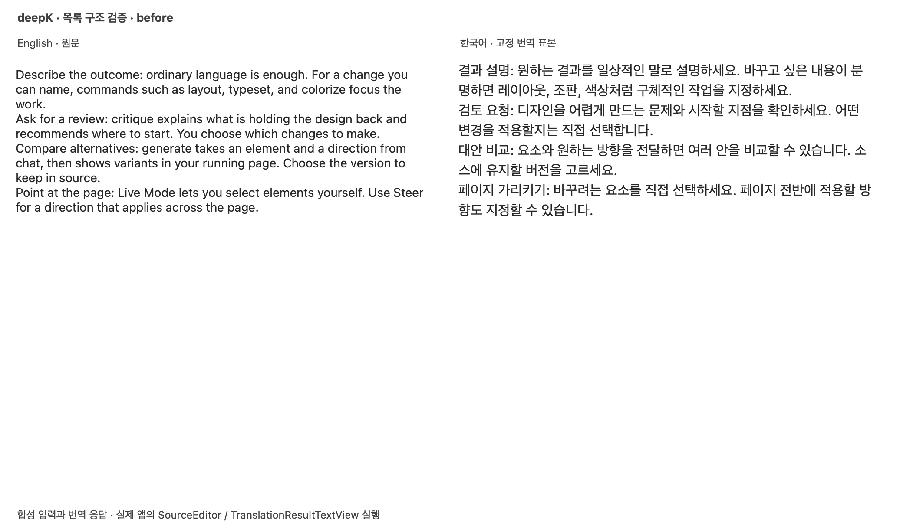
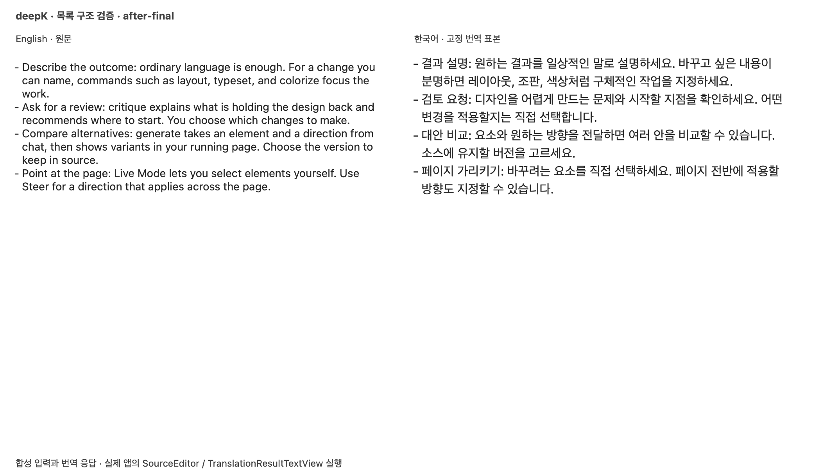
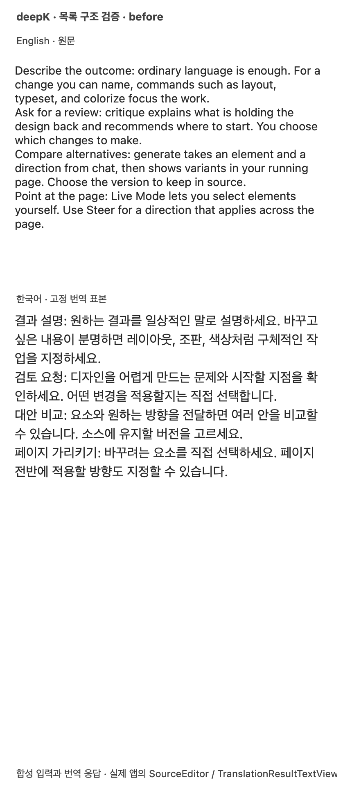
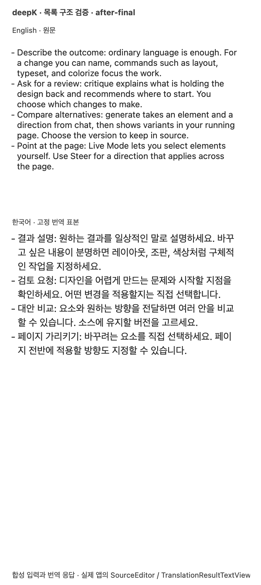

# 번역 포맷 안정화 검증 — 2026-10-17

기존 원하는 동작 7개는 모두 재현 후 수정했다. 자동 감지 2개, 복사 영역 뒤 문단 추가·전체 재번역 2개, HTML 목록 3개다. 최종 제품 코드 `5e9ffd3`의 [최종 엄격 실행 결과](final-strict.json)는 **36 PASS, 0 XFAIL, 0 FAIL, 0 XPASS**다. [초기 수정 결과](strict-fixed.json)와 [실패 목록을 비우기 전 결과](strict-before-unquarantine.json)는 원래 7개 모두 XPASS였음을 남긴다.

36개는 저장된 실제 응답 20개, 원하는 동작 계약 13개, 검사기 정책 3개다. 과거 잘못된 응답의 재생은 당시 관측을 보존하는 검사이며, 현재 모델이 올바르게 번역한다는 뜻이 아니다. 이번 수정·재실행의 실제 번역 요청은 0회다. 저장된 응답은 변경하지 않았다. [검사기 변형 7종](oracle-mutations.json)은 숫자 변경·표 값 교환·누락 응답·XFAIL 뒤 새 오류·남은 XPASS를 검출하는지 확인한다.

제품 수정의 [최소 비활성화 변형](product-mutations/summary.json)도 확인했다. 동일 소스 정상본은 36 PASS, 언어 대체만 끄면 34 PASS·2 FAIL, 접두부 보존만 끄면 34 PASS·2 FAIL, 목록 기호만 버리면 30 PASS·6 FAIL(원래 목록 3개와 추가 lifecycle 3개)이다. **원래 7개 ID 모두 해당 수정이 없으면 실패한다.** 각 사본의 최소 diff와 엄격 보고서를 보존했고, 컴파일한 소스·픽스처 SHA-256이 제품 수정 커밋 `492a9b1`과 일치한다.

## 실제 네이티브 컴포넌트 전후 화면

최종 이후 화면은 `5e9ffd3`에서 다시 캡처했다. 이전 이후 화면·수치도 원본 파일로 보존한다. 아래 이미지는 제품의 `RichSourceImporter`, `SourceEditor`, `TranslationResultTextView`를 실행해 캡처했다. 입력은 사용자 화면의 네 항목을 옮긴 **합성 HTML**, 응답은 **고정 한국어 예시**다. 전체 앱 실행, 실제 Chrome 클립보드 캡처, 모델 품질, 외부 앱 삽입의 증거로 쓰지 않는다. 일반 클립보드는 읽거나 쓰지 않는다.

| 변경 전: 기호 없음 | 변경 후: 항목 기호·내어쓰기 |
| --- | --- |
|  |  |
|  |  |

[변경 전 수치](before.json)와 [최종 변경 후 수치](after-final.json): 두 폭에서 원문 기호 0→4, 다음 줄 들여쓰기 0→10.24pt, TextKit 2 유지, 복사 원본 `raw` 보존. [최종 변경 후 HTML](after-final-copy.html)은 `ul/li` 네 항목을 포함한다.

재현: `./scripts/render-format-fixture.sh <새 출력 디렉터리> after`. 기준 버전은 `DEEPK_FORMAT_SOURCE_ROOT=<기준 checkout>`을 지정한다. 실행 중인 앱을 종료하거나 재시작하지 않는다.

## 최종 가져오기 CPU 비용

기준 `f0de4d1`의 제품 코드는 main `f1203d4`와 같다. 최종 측정 소스는 `5e9ffd3`과 SHA-256이 일치한다. [최종 원본 수치](review-followup/importer-final-metrics.json)와 [동일 하네스](benchmark.swift)를 보존했다. 초기 개발 중 [측정 원본](metrics.json)도 덮어쓰지 않았다. MacBookAir10,1 arm64, macOS 26.6.2, Swift 6.2.1, 동일 `-O` 빌드·입력이다.

각 입력·버전마다 2회차 × 7배치 × 300회 = **4,200회**(회차별 준비 100회 별도). 실행 순서는 before→after, after→before다. 표는 각 회차의 배치 평균 중앙값이며 공유 호스트의 변동을 포함한다. 백분율 속도 향상이나 p95를 주장하지 않는다.

| 입력 | 변경 전 µs, 1/2회차 | 변경 후 µs, 1/2회차 | 차이 µs, 1/2회차 | 보존 결과 |
| --- | ---: | ---: | ---: | --- |
| 네 항목 불릿 | 707.20 / 827.34 | 1033.20 / 1146.54 | 326.00 / 319.20 | 기호 0→4 |
| 시작·중간 번호 | 183.38 / 204.69 | 293.70 / 291.05 | 110.32 / 86.36 | 번호 없음→3, 7 |
| 중첩 목록 | 271.13 / 303.87 | 498.98 / 463.29 | 227.85 / 159.42 | 깊이 없음→0, 1, 1, 0 |
| 링크·칩 대조군 | 371.25 / 434.70 | 377.71 / 386.85 | 6.46 / -47.85 | 링크 1·칩 1·raw 유지 |

불릿 복원에 약 0.32–0.33ms가 추가됐다. 최종 불릿 회차 중앙값은 약 1.03–1.15ms다. 작은 합성 입력의 CPU 비용이며 실제 앱 전체 지연을 보장하지 않는다. 모델 첫 응답·완료 시간, 메모리, 전체 GUI·레이아웃, 언어 감지·구조 보존의 별도 시간은 미측정이다.

재현은 각 checkout의 `TranslationLists.swift`(있는 버전), `TranslationMarkup.swift`, `CopiedMathNormalizer.swift`, `RichSourceImporter.swift`와 `benchmark.swift`를 `swiftc -O -swift-version 6 -warnings-as-errors`로 각각 컴파일한 뒤, 동일 `DeepKTests/Fixtures/Formatting/list-inputs.json`을 인자로 실행한다. 원본 결과를 덮어쓰지 않고 별도 디렉터리에 저장한다.

## 최종 긴 응답 파서 CPU 비용

[3버전·3회 원본](review-followup/parser-final-metrics.json)과 [하네스](review-followup/parser-benchmark.swift)는 같은 224,000byte 합성 응답(8,000 코드 블록)을 순서를 바꿔 측정했다. 응답 한도 256,000byte 이내이며 실제 번역·GUI 지연은 아니다. 기준 main과 제품 코드가 같은 `f0de4d1`, 리뷰본 `142e5e4`, 최종 `5e9ffd3`을 비교했다.

| 버전 | 3회 개별값 s | 중앙값 s |
| --- | --- | ---: |
| main 기준 | 0.152 / 0.141 / 0.269 | 0.152 |
| 리뷰 전 수정본 | 1.406 / 1.497 / 1.976 | 1.497 |
| 최종 수정본 | 0.162 / 0.208 / 0.446 | 0.208 |

반복 제외 탐색으로 생긴 리뷰본의 지연을 제거했다. main 대비 최종 중앙값에는 약 0.056초가 추가됐다. 작은 표본과 공유 호스트 변동이 있어 일반적인 앱 속도 향상으로 해석하지 않는다. 4,000블록 최종값에도 1.108초의 이상치가 있어 원본에서 숨기지 않았다. 각 실행의 표시 바이트 수·블록 수는 같고, 별도 stress 검사에서 코드 제외·목록 경계를 확인했다.

[독립 리뷰의 최초 측정](review-followup/parser-review-original-metrics.json)은 다른 부하에서 수행했으므로 이 표와 절대값을 섞지 않는다. [리뷰 5건의 반영·변형 검증](review-followup/README.md)도 함께 남겼다.

## 범위와 남은 확인

- 바이트가 같은 복사 접두부 뒤에 입력을 추가하는 경우 구조를 보존한다. 복사 영역 내부 수정이나 별도 복사본 여러 개를 하나의 문서에 합치는 문제는 #64의 후속이다.
- HTML과 평문이 대응하지 않는 부분 복사는 기호를 추측하지 않고 기존 텍스트를 유지한다.
- 목록 내부 `<pre>`는 코드 카드를 보존하지만 완전한 HTML 목록 포함 관계까지 복원하지 않는다.
- 실제 Chrome 복사, 전체 앱의 키보드·IME, 앱별 rich 붙여넣기·삽입, 실제 잠자기·깨우기는 별도 실환경 확인이 남는다.
