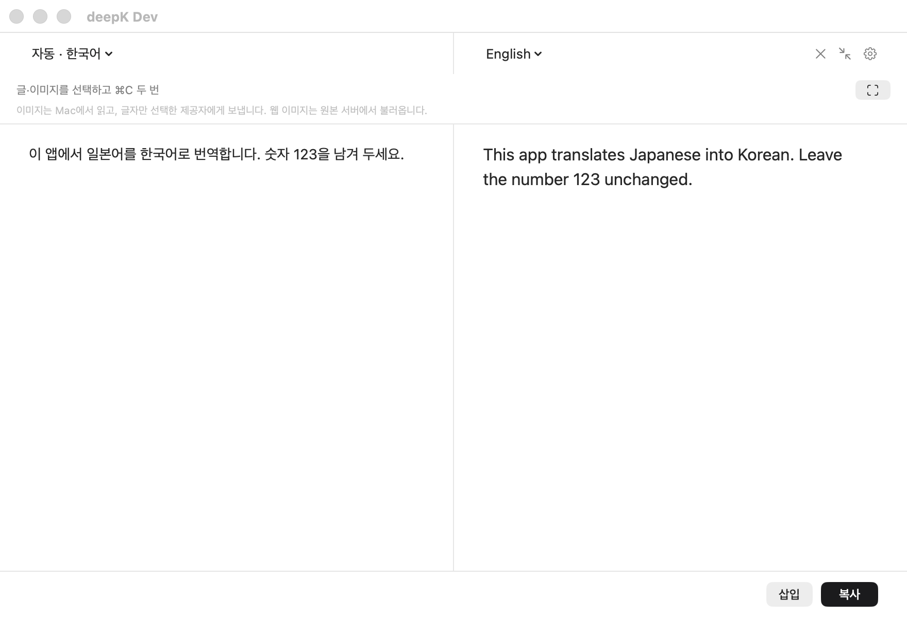
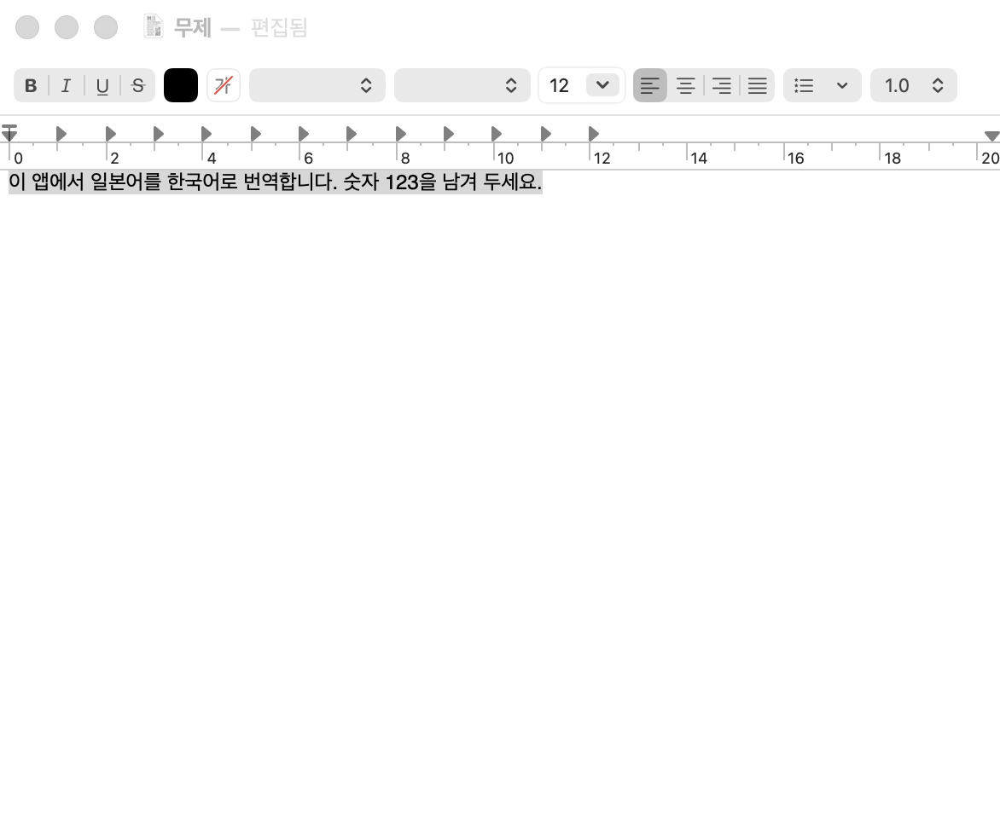

# 일본어·중국어 지원 구현 검증

날짜: 2026-11-15.

**최신 상태:** 권한 준비·실제 두 번 복사·원래 TextEdit 문서 삽입을 확인했다. 의미 보존 지시와 제한된 시간 상한 교정 경로를 보완한 Claude 33개 재검증 및 추가 9개 표본에서 이전 부정/누락/상한 오류를 발견하지 못했다. 아래 초기 실패·권한 대기 기록은 과거 관찰로 보존하며, 마지막 절의 최종 결과를 우선한다. 일반 번역 정확성이나 모국어 문구 검토 완료를 보증하지 않는다.

기반: 공개 main `5f1b55819e03b6254eae2f44af889150dea09a68`. 이 문서는 로컬 개발 변경과 직접 관찰한 증거를 설명한다. 릴리스·Homebrew 배포·태그·공증·외부 게시를 수행하지 않았다. 별도 deepK-public 체크아웃의 미커밋 변경도 수정하지 않았다.

## 구현

- 텍스트 원문/대상에 ko/en/ja/zh-Hant/zh-Hans 추가. 중국어 문자 체계가 미확정이면 source-only zh로 표현하고 수동 원문 선택을 제공한다.
- 기본 대상은 시스템 선호 언어 중 지원 언어, 설정에서 변경 가능. 원문과 기본 대상이 같으면 영어, 영어끼리는 대상 선택 안내. 번역 창의 대상 선택은 세션 내 적용한다.
- 기존 방향 설정을 별도 v2 설정으로 이관한다. 진행 요청 취소·문서 무효화·언어쌍 캐시 분리를 유지한다. 명확한 언어명을 사용하는 프롬프트와 이전 결과를 구분하는 캐시 컨텍스트는 languages-v3다.
- NLLanguageRecognizer의 가설을 제한하지 않는다. 새 ja/zh 판정은 0.8 및 0.2 차이를 기본으로 사용하되 기존 en/ko 최상위 판정은 짧은 hello 호환성을 유지한다. 충분한 한자 산문에서는 API/JSON 같은 대문자 약어를 감지에만 제외한다. 입력 원문은 변경하지 않는다.
- 일본어/중국어의 공유 한자는 원문 반복으로 재요청하지 않는다. 한국어 결과에만 기존 한자 독음 치환을 적용한다.
- 메뉴·설정·상태·접근성 안내·복사 형식 등 String Catalog 262개 키, ko/en/ja/zh-Hant. 간체 UI는 영어 선택. 일본어·대만 문구는 모국어 검토 전 초안이다.
- 이미지 번역은 기존 한영 언어 계약을 보존한다. 이미지가 활성화되면 기존 한영 방향 메뉴와 실제 이미지 언어를 표시한다. 텍스트 대상 설정이 이미지에도 적용된다고 오해하지 않도록 설정에 범위를 안내한다.
- 구독만 사용하며 제공자/상위 모델/API 자동 전환이나 추가 결제를 도입하지 않았다.

## Paper MCP: 원인 가설과 런타임 복구

직접 관찰한 배포 앱 `/Applications/deepK.app` 0.2.0 (48), PID 1122에 `-32600 / invalid transport in mcp_servers.paper`가 표시돼 있었다. 설정에는 Codex 연결 당시 버전 0.166.0이 남아 있었다.

앱을 종료하지 않고 deepK의 연결 해제(로그아웃 아님) → 연결 확인을 수행했다. Codex 표시가 0.169.0으로 갱신됐다. 기존 Playwright 관련 영어 원문을 유지한 채 같은 원문을 다시 요청했고 한국어 결과가 나타났다. 원문을 바꾸거나 전역 MCP 설정을 수정하지 않았다. 재요청을 위해 같은 원문을 넣고 끝 공백 하나를 입력·삭제했으며 최종 원문은 동일하다. 결과 PNG는 `00-paper-mcp-recovered.png`다.

이 복구 사실만으로 실제 paper 삭제 이력까지 증명하지는 않는다. 코드상 원인은 연결 시 저장한 서버 이름으로 계속 enabled=false override를 만드는 경로이며, 삭제된 이름은 transport가 없는 설정을 만들 수 있다.

재발 방지 구현은 번역 및 thread/start 전에 config/read로 현재 이름을 읽고, 이름이 바뀌면 준비 작업·준비 스레드를 무효화한다. 명시적 연결 갱신도 동일하게 처리한다. config/read 직후 삭제가 경합해 특정 -32600 invalid transport 오류가 발생하면 이름 변경을 확인한 경우에만 모델 turn 시작 전에 한 번 재시도한다. 설정이 그대로 잘못된 경우 재시도 루프 없이 오류를 유지한다. 전역 설정은 쓰지 않는다.

모의 RPC 검사에서 삭제/추가, 대기 스레드 무효화, 읽기 직후 삭제 경합, 바뀌지 않은 잘못된 설정의 무재시도, 기존 도구 차단·취소·계정/모델 캐시 검사 통과. 이는 모의 서버 검증이며 실제 배포 앱에 패치를 설치한 것은 아니다.

## 실제 앱/제공자 관찰

개발 앱은 배포 앱과 다른 `com.deepk.app.dev`를 사용했다. 테스트 문장을 실제 앱에 입력하고 AX 상태 및 창 PNG로 결과를 확인했다. 자동 검사 결과로 GUI 성공을 대신하지 않았다.

| 제공자 | 직접 확인한 방향 | 증거 |
| --- | --- | --- |
| Codex / gpt-5.6-luna | 사용자 일본어 문장→한국어 | 01-japanese-source-to-korean.png |
| Codex / gpt-5.6-luna | 한국어→일본어 | 02-korean-to-japanese.png |
| Codex / gpt-5.6-luna | 한국어→대만 번체 | 03-korean-to-taiwan-traditional.png |
| Codex / gpt-5.6-luna | 한국어→간체 | 04-korean-to-simplified.png |
| Codex / gpt-5.6-luna | 영어→일본어 | 최종 MP4 마지막 구간 |
| Codex / gpt-5.6-luna | 대만 번체→한국어 | 09-traditional-source-to-korean.png |
| Codex / gpt-5.6-luna | 간체→한국어 | 10-simplified-source-to-korean.png |
| Claude Code / claude-haiku-5-5 | 간체→한국어 | 11-claude-simplified-source.png |

Claude 일본어→ko 초기 실측에서는 한국어 대신 일본어 재서술이 나왔다(`12-claude-japanese-before-prompt-fix.png`). 이를 성공으로 분류하지 않는다. 한국어를 `Korean (한국어)`로 명시해 같은 앱 클라이언트로 직접 요청한 공개 샘플 세 개(ja/번체/간체)에서는 한국어 결과를 받았다(`claude-language-probe.json`). 직접 클라이언트 호출과 앱 화면 검증은 구분한다. 최종 앱을 재실행한 뒤 같은 일본어 문장이 Claude Code에서도 한국어로 번역됨을 AX로 확인했다. 수정 후 PNG는 `13-claude-japanese-after-prompt-fix.png`다.

## 영상·PNG

위 파일은 `~/Downloads/deepK-ja-zh-review/`에 모았다. `deepK-ja-zh-review.mp4`는 H.264, 1280×900, 59.9초, 음성 없는 실제 앱 창 녹화다. 원본 07/08 MOV 두 개에서 대기를 줄인 세 구간을 연결했다. 재생 속도를 바꾸거나 번역 결과·화면을 합성하지 않았다. 실제 기록 구간은 첫 MOV 1–18초, 34–60초, 둘째 MOV 0–17초다. 원본 MOV도 보존했다.

PNG를 열어 실제 앱 창인지 확인했고 MP4의 시작·중간·마지막 프레임을 점검했다. 설정 화면은 05-settings-target-language.png다. 화면에는 공개 테스트 문장만 사용했으며 비밀번호·토큰을 표시하지 않았다.

## 자동 검사와 한계

- Xcode Debug 개발 앱 빌드 성공. 배포/개발 앱 identity 검사 통과.
- 다섯 언어 샘플, 한자 짧은 단어·코드/URL/숫자, 설정 마이그레이션, 영어→영어 안내, 수동 대상, 늦은 응답 무시, 중국어 무변형, 기존 증분·캐시·원문 반복·코드 보존 Store 검사 통과.
- 실행 중 컴파일과 겹친 400ms 캐시 만료 경계 검사가 한 번 실패했고, 동일 바이너리의 재실행에서 Store 전체가 통과했다. 전체 검사가 한 번에 모두 통과했다고 기록하지 않는다.
- 포맷 회귀 36개 통과. 기존 이미지/OCR/배치/입력 복구 모의 검사 통과; 실제 이미지 제공자·화면 스캔 검증으로 보지 않는다.
- MCP/제공자/출력 검사, 표시 관련 후속 검사의 최종 결과는 아래 후속 결과에 기록한다.
- String Catalog 참조 키 258개, 전체 262개 및 네 UI 언어의 누락/자리표시자 검사 통과.

**미검증:** 개발 앱의 입력 감시가 연결되지 않아 실제 다른 앱에서 ⌘C 두 번 호출·삽입·복귀를 확인하지 않았다. OS 권한을 임의로 허용하거나 TCC를 초기화하지 않았다. 영상도 직접 입력 흐름이며 메뉴 막대 호출/두 번 복사 성공 영상으로 주장하지 않는다. 일본어·대만 UI 전체의 모국어 검토, 여러 OS 버전, 11개 방향×3표본×2제공자의 전체 품질 매트릭스, 실제 부정/전문 용어 품질 검토 및 릴리스 검증은 완료되지 않았다.

Computer Use 접근 승인 문제와 Paper RPC 오류를 분리했다. 도구가 승인 실패를 반환한 후 실제 지연 실행이 관찰되기도 했으므로 “사용자가 승인하지 않았다”고 결론 내리지 않는다. 승인 저장 설정을 직접 수정하지 않았다.

## 후속 결과

- 최종 개발 앱 빌드 성공. 재실행한 앱에서 Claude Haiku 5.5의 같은 일본어 문장→한국어 결과를 확인하고 PNG 13을 저장했다.
- 검증 뒤 제공자 선택을 Codex로 되돌렸고, 최신 앱에서도 같은 일본어→한국어 번역이 되는 것을 확인했다. PNG 01은 이 최종 결과로 갱신했다. 기본 대상 설정은 시스템 언어를 유지했다.
- 복구 당시 배포 앱과 초기 개발 앱은 npm Codex 0.169.0을 사용했다. 최종 개발 앱 재실행에서는 탐색기가 ChatGPT 번들 Codex 0.167.0-alpha.4.1을 골랐고, 위 재번역도 성공했다. 실행 파일을 수동 교체하거나 전역 경로 설정을 변경하지 않았다. CLI 버전을 동일하다고 가정하지 않는다.
- 번역 결과 뷰·SourceEditor·Footer·ResultStyle·코드 스타일 모델/화면·SyntaxHighlighter 검사 통과. Claude transport와 DoubleCopyMonitor 권한 모의 검사도 통과.
- 최종 Store 재검사 통과: 다국어 표본과 기존 IncrementalTranslation/OutputCheck/CodeBlockStore 전체 포함.
- PermissionPresentation, WindowPresentation, PermissionGuideLayout/Lifecycle, LoginItemController 검사 통과.
- 이 결과는 여러 단계의 실행 로그를 합친 것이다. 최초 전체 스크립트는 시간 경계 검사 및 실행 중 소스 변경으로 중단됐으며, 해당 검사와 그 이후 검사들을 소스 고정 후 다시 실행해 통과했다.
- 최종 Debug 빌드 로그: `/private/tmp/deepk-language-build-delivery.log`; 최종 Store: `/private/tmp/deepk-language-focused-final.log`; 나머지 표시/권한: `/private/tmp/deepk-language-ui-tail.log`; MCP: `/private/tmp/deepk-mcp-tests.log`. 이 로그들은 로컬 진단용이며 배포 파일이 아니다.
- 실제 ⌘C 두 번/삽입 검증은 개발 앱 권한에 대한 사용자 선택을 기다린다. 현재 산출물은 그 승인을 전제로 성공을 주장하지 않는다.
- 영상과 PNG 02–04, 09–12는 구현 중 동작 확인 빌드에서 촬영했다. 최종 재실행 상태는 PNG 01·05·13으로 구분한다. 모든 파일이 같은 실행 세션에서 만들어졌다고 주장하지 않는다.

## PR 준비 재점검 및 로컬 업데이트 (추가 요청)

- 최신 공개 main은 여전히 `5f1b55819e03b6254eae2f44af889150dea09a68`임을 원격에서 확인했다. 현재 변경은 미커밋이고 PR·push를 하지 않았다.
- 실제 권한 세션은 입력 모니터링의 파일 선택 창에서 `deepK Dev`가 보이고 **열기** 버튼이 대기 중이다. Touch ID 인증 완료와 앱 추가·권한 허용 완료는 다른 상태다. 손쉬운 사용도 아직 확인하지 못했다.
- 독립 가능한 PR 범위는 ① Paper MCP 목록/standby 갱신, ② 다국어 감지·대상 설정·UI 현지화다. 기존 [Draft PR #2](https://github.com/Geuni620/deepK/pull/2)는 12언어 및 후속 질문을 함께 포함하며 현재 main과 충돌한다. 해당 PR을 수정·닫거나 그 변경을 덮어쓰지 않았다.

### 전체 방향 실호출: 품질 게이트 미통과

실행: `bash scripts/test-multilingual-live.sh --live <result.json>`.

직접 작성한 `benchmarks/ja-zh-samples.json`의 부정/숫자/날짜, 문단/코드, 가능성/요청 표본을 11방향×3표본×2제공자, 정확히 66회 호출했다. 자동 재시도나 모델 전환은 없었다. 양쪽은 기존 구독 경로다. 전송 오류·빈 결과·숫자/코드 누락은 0건이지만 **이는 의미 정확성 검사 통과가 아니다.**

직접 읽어 확인한 문제:

1. Claude Haiku 5.5, ko→zh-Hant: `백업을 삭제하지 마세요`가 `刪除備份`로 부정 반전됨. 차단 항목.
2. Claude Haiku 5.5, zh-Hans→ko: `请勿删除备份`의 `백업` 목적어가 누락됨. 차단 항목.
3. Claude Haiku 5.5, ja→ko 가능성 표본: 원문에 없는 `최대`라는 시간 상한을 추가함. 추가 검토 항목.

출력 원본은 `full-language-matrix.json`, 직접 검토 결과는 `full-language-matrix-review.json`에 보존했다. Codex 표본에서는 위 의미 반전·명시적 누락을 발견하지 못했지만, 모국어 검토 완료나 일반 품질 보증으로 표현하지 않는다. 일부 코드 문장의 인라인 코드가 별도 fence로 바뀐 출력도 있어 형식 차이로 기록한다.

부정 반전의 원인을 좁히기 위해 **별도 2회**만 같은 ko→zh-Hant 합성 문장을 호출했다(스트리밍 1회, one-shot 1회). 두 결과는 정상이고 스트리밍의 delta/assistant/result도 일치했다. 최초 실패를 수정하거나 정상으로 덮어쓰지 않았다. 이 증거만으로 모델과 CLI 중 원인을 확정하지 않는다. 전체 방향 66회와 진단 2회는 기존 대표 표본/GUI 호출과 별도이며, 전체 작업의 총 구독 호출 수를 68회라고 주장하지 않는다.

최종 판단: 대표 GUI와 자동 회귀는 통과했지만 전체 품질 게이트와 실제 ⌘C 두 번·삽입 게이트가 미충족이므로, 사용자가 조건부로 요청한 PR 게시를 실행하지 않았다. 무조건적 모델 재시도·유료 API·모델 자동 전환으로 우회하지 않았다.

### 로컬 설치 패키지

실행: `bash scripts/package-release.sh --local --version 0.3.0`.

Release 빌드와 번들 검사·이미지 기능/테스트 진입점 제외·recipient notices·추출 ZIP CRC·SHA256·codesign strict 검증 통과. `com.deepk.app.dev`, 0.3.0 (59), arm64, macOS 15+, ad-hoc, notary not-run, dirty=true다. 기존 배포 앱을 종료·설치·덮어쓰지 않았고 이 패키지를 실제로 실행하지 않았다. 개발 앱의 권한·서명 경로가 달라 재확인이 필요할 수 있다.

위치: `~/Downloads/deepK-ja-zh-review/update/deepK-local-0.3.0-arm64-5f1b55819e03-dirty.zip`.

SHA256: `06817ac81772a2185e7e5b9ffb1f6c665e0b3671c29c12231945dc485a29d145`.

이것은 알려진 품질 실패가 남은 로컬 검토본이다. 정식 업데이트나 타인 배포용으로 권장하지 않는다. 설치 시 macOS 보안 기능을 끄는 우회 절차를 제공하지 않았다.

### 다른 사용자 안내

GitHub 공개 최신은 [v0.2.0](https://github.com/Geuni620/deepK/releases/tag/v0.2.0)이며 조회 시 ZIP download_count는 6이었다. 다운로드 수로 본인/타인 구분이나 실제 활성 사용자 수를 판단할 수 없다. 공개 0.3.0이 없고 품질 검증도 미통과이므로 다른 사용자에게 업데이트 메시지를 보내지 않았다. `docs/ja-zh-update-notice-draft.md`는 정식 공개 후 사용할 초안일 뿐이며 외부에 게시하지 않았다.

## 최종 품질 보완 및 실제 앱 간 검증

### 확인된 수정과 비용

- Claude 시스템 지시에서 절별 주체·행동·목적어, 부정/예외/조건, 가능성·의무·불확실성을 보존하도록 명시했다. 단순 지시 보완만으로는 초기 일본어 시간 상한 오역이 남았으므로 그것만을 해결 증거로 삼지 않았다.
- 숫자·시간 단위·명시적 가능성 표현이 있는 산문에서 원문에 없는 상한 표현이 추가됐는지 좁게 검사한다. 코드·URL은 검사에서 제외한다. 상한이 명시된 원문은 그대로 허용한다.
- 위 검사에 걸린 경우 같은 구독·같은 모델에서 교정을 **최대 한 번** 요청한다. 재검사도 실패하면 오류로 반환해 성공 결과·캐시에 넣지 않는다. 시간 산문은 첫 후보를 스트리밍으로 노출하지 않고 확인된 결과만 전달한다.
- 이는 범위가 제한된 검출기다. 모든 의미 오류·모든 시간 표현·부정의 범위를 보증하지 않으며, 보편적 번역 품질 검증기로 설명하지 않는다. 감지된 요청은 구독 사용량과 지연이 늘 수 있다. API/모델 자동 전환은 없다.
- 원문+초기 번역 후보가 동일 제공자의 교정 요청에 다시 들어갈 수 있다. 새로운 수신자에게 전송하지 않는다. 원문/번역을 로그로 남기는 기능은 추가하지 않았다.
- Claude 캐시 컨텍스트는 v4로 바꿔 이전 프롬프트 결과를 재사용하지 않는다.

### 재검증

- `ClaudeTransportTests`의 스트리밍/one-shot 양쪽에서 잘못된 초안 차단, 한 번 교정 후 정상 결과, 반복 실패 차단, 정확히 2회 요청 상한을 확인했다. 기존 인증/API 차단·취소·대기 프로세스 검사도 통과했다.
- **최종 Claude 매트릭스:** 11방향×3표본 = 33개, 전송 오류 0, 숫자·코드 누락 0, 실제 자동 교정 0회. 33개 출력을 읽어 이전 부정 반전·목적어 누락·추가 시간 상한이 재현되지 않음을 확인했다. 이전 Codex 33개는 프롬프트를 바꾸지 않아 다시 소비하지 않았다.
- **추가 표본:** 기존 시간 문장 1개와 새 부정·예외·부정된 상한·가능성 문장 8개, 총 9개. 최종 클라이언트에서 모두 응답했고 자동 교정 0회였다. 직접 검토에서 같은 오류를 발견하지 못했다. 모국어 검토와는 별개다.
- 보완 과정의 요청 수는 단계별로 분리한다: 초기 66개 전체 매트릭스, 최초 진단 2회, 지시 보완 v2 33개, v3 추가 표본 9개, 최종 v4 33개 및 9개. GUI·그 이전 대표 표본 요청은 이 합계에 포함하지 않는다. 자동 교정 네트워크 경로는 최종 표본에서 필요하지 않았으므로 강제 모의 응답으로만 검증됐다.
- 원본 실패와 최종 결과 JSON을 이 디렉터리에 함께 보존한다. `benchmarks/ja-zh-fidelity-holdouts.json`은 직접 작성한 추가 표본이다.

### 실제 권한·호출·삽입 (대기 해소)

사용자가 macOS 권한을 허용한 뒤 앱 설정의 **권한 준비됨**을 AX에서 직접 확인했다. 이미 허용된 권한을 다시 요청하거나 변경하지 않았다.

사용자가 TextEdit에서 `このアプリで日本語を韓国語に翻訳します。数字123を残してください。`를 선택해 실제 키보드로 ⌘C를 두 번 눌렀다. 이후 다음을 직접 관찰했다.

1. deepK Dev가 일본어 원문과 한국어 결과를 표시하고 **삽입** 버튼을 제공했다.
2. 삽입 버튼을 눌러 앱의 **삽입됨** 표시를 확인했다.
3. TextEdit의 선택된 내용이 `이 앱에서 일본어를 한국어로 번역합니다. 숫자 123을 남겨 두세요.`로 실제 교체된 것을 AX에서 확인했다.

자동 조작의 복사 키가 처음에는 전역 감지기로 들어오지 않았으므로 그 시도를 성공으로 기록하지 않는다. 실제 키 입력 단계는 사용자, 삽입 조작과 문서값 확인은 어시스턴트가 수행했다. 사용자 스크린샷에서는 기존 배포 앱은 한영 제한 오류, 개발 앱은 정상 결과를 동시에 보였다. 기존 배포 앱의 언어 기능을 업데이트했다고 주장하지 않는다.

기존 59.9초 MP4는 계속 직접 입력 영상으로 분류한다. 후속 실제 키 입력·삽입은 위 PNG와 관찰 기록이며, 이 단계까지 같은 MP4에 담겼다고 주장하지 않는다.

### PR·업데이트 판단

확인된 초기 차단 항목은 위 한정된 검증 범위에서 해소됐다. 최종 커밋에서 자동 검사·빌드를 확인한 뒤 요청받은 PR을 게시한다. 배포/태그/공증/타인 메시지는 별도이며 PR 생성으로 실행하지 않는다. 일본어·대만 UI의 모국어 검토와 여러 macOS 버전 검증은 릴리스 후속 항목이다.

### PR 분리 검사 중 테스트 시작 대기 보완

MCP만 추출한 커밋 스냅샷에서 기존 대기 스레드 정리/계정 검사 두 곳이 서로 다른 실행에서 `timeout(initialize)`로 중단됐다. 2초의 모의 CLI 시작 제한이 빌드 병행 부하에 민감했다. `makeClient`의 requestTimeout만 10초로 분리하고 명시적 translationTimeout 기반 시간 초과 검사는 그대로 유지했다. 제품의 20초 연결 제한을 늘린 변경이 아니다. 해당 테스트 보완은 MCP PR의 별도 로컬 커밋 `2f21683`으로 분리했다. 최종 스냅샷 검사 결과는 PR 본문에 기록한다.

### 최종 PR 경계 검증 메모

MCP PR 최종 스냅샷 `2f21683`에서 Codex 전송·실행 파일 탐색 전체 회귀 검사가 통과했다. 후속 언어 변경을 넣지 않은 독립 스냅샷이다. 초기 두 번의 모의 CLI 시작 타임아웃과 최종 통과를 구분한다.

자동 시간 검출은 **명시적 가능성 표현**과 숫자/시간 단위가 모두 있는 산문에만 적용한다. 원문에 표현된 최대·최소·부정형 한도는 보수적으로 검사에서 제외해 강제로 다시 쓰지 않는다. 이는 포괄적 의미 판정기가 아니다. 교정 초안도 데이터로만 전달하고, 실제 원문의 한도는 보존하도록 지시한다. 단일/스트리밍 모의 검사에서는 재실패의 성공 반환·캐시화를 막는 것과 추가 요청 1회 상한을 확인했다.

현재 String Catalog는 참조 260개 키 / 전체 264개 항목 / ko,en,ja,zh-Hant다. 새 오류와 Claude 추가 요청 가능성 안내도 네 언어에 포함했다. 이전 개수는 해당 시점 기록으로 보존한다.

### 전체 오프라인 검사 통과와 최종 문구 보완

커밋 `91d4ea18a0290046a08491859c30834cf71a04ae`에서 `bash scripts/test.sh` 전체를 1회 실행해 exit 0으로 통과했다. 이미지/입력 복구 모의 검사, 36개 포맷 회귀(PASS=36, XFAIL=0, FAIL=0, strict 미실행), Store/증분/캐시, 두 제공자 전송, 출력/한자/구조, 결과 뷰/편집기/스타일, 권한/창/로그인 항목 검사를 포함한다. 이는 뒤의 개별 재실행을 합친 결과가 아닌 한 번의 전체 스크립트 결과다. `bash scripts/build.sh`와 `bash scripts/package-release.sh --local --version 0.3.0`도 같은 커밋에서 통과했다.

이후 검토에서 초기 화면의 기본 안내 툴바에 남아 있던 한국어 상수 11개를 카탈로그로 옮기는 문구 전용 보완을 했다. 조건·버튼 동작·이미지 처리 로직은 바꾸지 않는다. 이 후속 커밋은 문자열 누락/자리표시자 검사 및 Debug/로컬 Release 빌드로 검증하며, 전체 스크립트는 위 커밋에서 실행한 것으로 구분한다. 이미지 전용 상세 오류·외부 CLI 메시지의 전면 현지화와 모국어 검토는 후속 범위다.

## 독립 리뷰와 정상 상한 오인식 수정

고정 head `97f30b4`를 네 관점으로 순차 독립 검토했다. 리뷰어들은 재현된 도입 결함 0건을 보고했으며, 정적 검토와 좁은 현지화/모의 Codex 검사·변형 검사 범위를 구분했다. 현지화 함수가 원문 키만 반환하는 변형도 정적 검사를 통과해, 번들 조회 실행 검증을 대체하지 못함을 확인했다.

메인 세션의 추가 재현에서는 `The update may take 4 minutes or less.`와 올바른 `업데이트에는 최대 4분이 걸릴 수 있습니다.`를 시간 상한 오역으로 오인해, 모의 CLI에서 2회 요청 후 정상 번역을 거절하는 P2를 확인했다. source 상한 목록에 `or less`가 없었기 때문이다. PR #19에 지적으로 남긴 뒤 수량·시간 단위에 붙은 `or less`와 `as long as`를 인식하고, 두 전송 방식에서 정상 번역을 교정 없이 1회로 반환하는 회귀 사례를 추가했다. 이전 교정 결과를 재사용하지 않도록 Claude 캐시 컨텍스트를 v5로 분리했다.

이번 리뷰/수정 검증에는 실제 앱을 재실행하거나 실구독 번역을 추가 호출하지 않는다. 원본 실패 표본과 이전 검증 기록은 수정하지 않는다. 최종 커밋의 전체 테스트·빌드·변형 결과는 PR 답글에 기록한다. 머지·정식 배포는 수행하지 않는다.

영어 표현을 단순 키워드로만 추가하지 않고 수량·시간 단위에 붙은 구문으로 제한했다. `as long as backups are kept` 같은 보관 조건이 시간 상한으로 오인돼 기존 검사를 우회하지 않는 반대 사례도 추가했다.

### 취소 직후 예열 경로 테스트의 스케줄 의존 단언 보완

리뷰 수정 `8c0c6df`의 첫 전체 검사와 동일 바이너리 재실행에서 `cancelMidStreamThenRetranslate`가 `onDemandStream` 대신 `bootingSpare`를 관찰해 실패했다. 제품은 취소 정리가 먼저 끝나면 새 대기 프로세스를 재요청에 제공할 수 있어, 경로명 하나로 정상 여부를 판단하는 기존 테스트가 스케줄 순서에 의존했다.

제품 코드는 바꾸지 않고 모의 fixture에 이 사례 전용 PID 기록을 추가했다. 재요청이 별도의 프로세스를 사용하는지, 자기 응답만 반환하는지, 취소 후 조각이 오지 않는지, 시작한 프로세스가 모두 종료되는지를 검증한다. 새 on-demand/새 booting/warm spare는 허용하되 one-shot fallback은 계속 실패로 처리한다. 원래 3개 spawn·2개 translation·종료 검증은 유지했다. 최종 전체 실행 결과는 PR 답글에서 별도로 기록한다.

해당 스위트의 첫 보완 실행에서는 모의 CLI 버전 조회의 3초 시작 제한도 한 번 초과했다. 테스트 helper의 requestTimeout만 10초로 분리하고, 짧은 translationTimeout 기반 취소/시간 초과 사례는 유지했다. 실제 제품 연결·번역 타임아웃은 변경하지 않았다.
