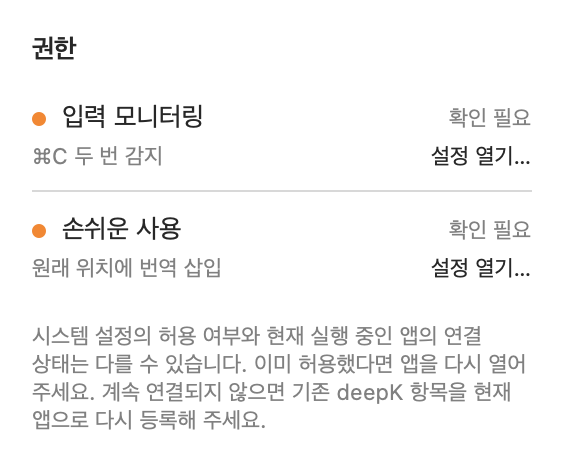
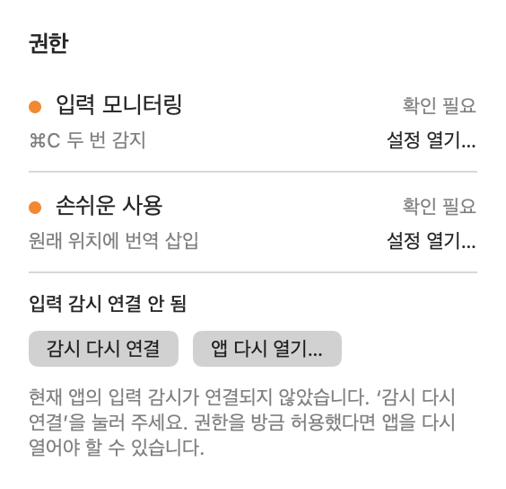
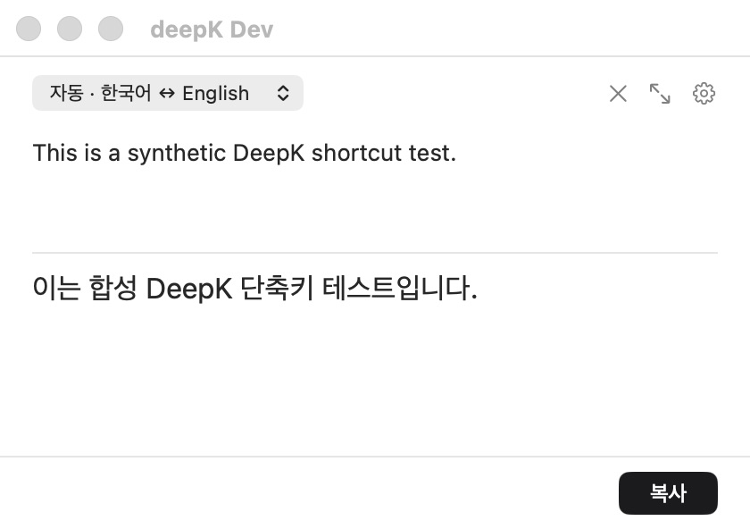
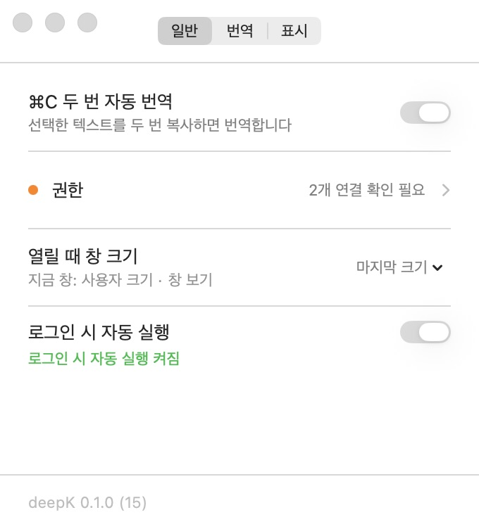
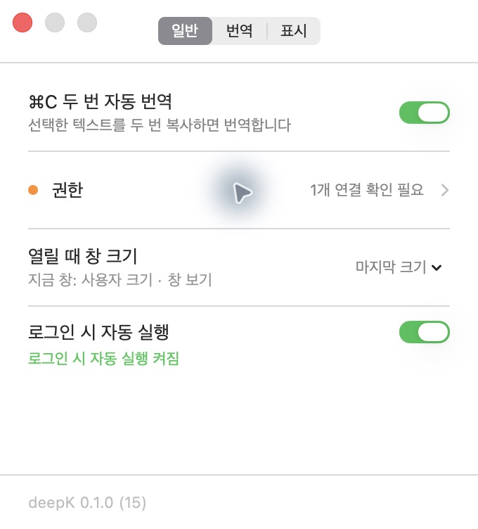
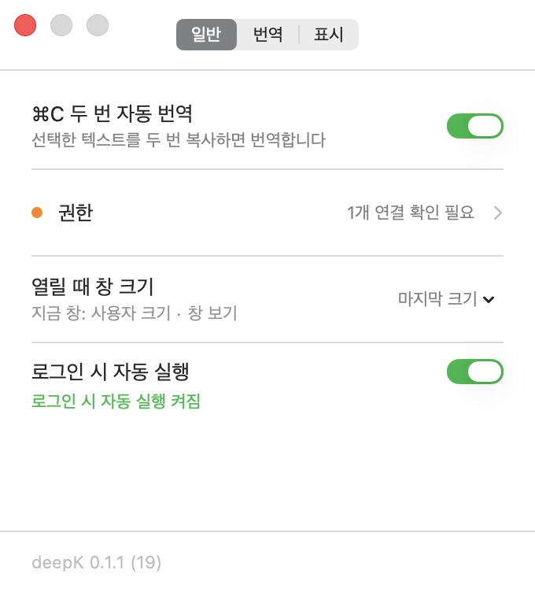
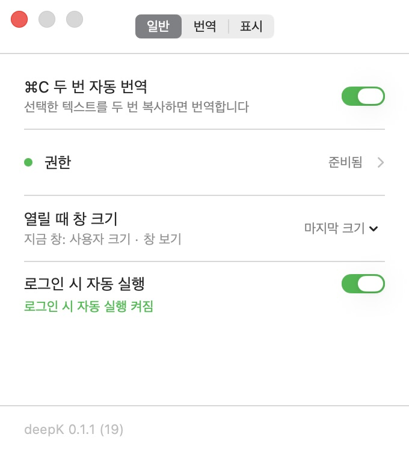
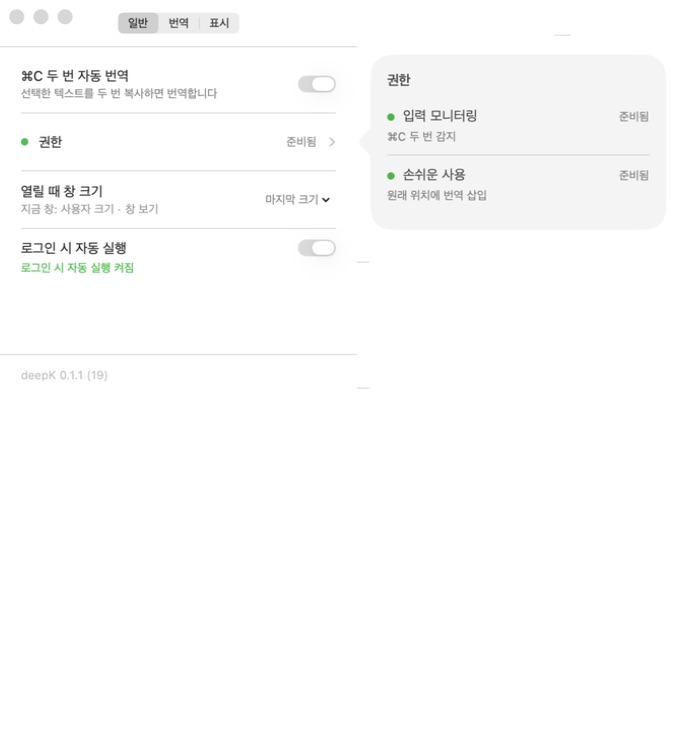

# 두 번 복사 단축키의 권한 분리와 deepK 이름 통일

## 문제와 원인

설정에서 입력 모니터링이 켜져 있어도 ⌘C를 두 번 눌렀을 때 번역 창이 열리지 않았다. 실행 중인 앱에서는 키 입력 감시 연결 실패가 표시됐다.

이 Mac의 TCC 로그에서 `com.deepk.app`의 기존 개발용 서명 조건과 실행 중인 배포용 서명이 일치하지 않는 것을 확인했다. 권한 스위치가 켜져 있다는 사실과 현재 프로세스가 키 이벤트를 받을 수 있다는 사실은 별개였다. 이전 촬영 작업에서도 개발 앱을 같은 식별자로 등록한 기록이 있었다. 녹화 프로그램 자체가 키 입력을 막았다는 증거는 확보하지 않았다.

코드에서는 다음 경로가 같은 앱을 가리켰다.

- Debug와 배포용 Release가 모두 `com.deepk.app`을 사용했다.
- 개발 실행 스크립트도 이 식별자의 실행 중인 앱을 종료했다.
- 공증하지 않은 `--local` 패키지도 배포 앱과 같은 식별자였다.
- 표시 이름은 `deepK`였지만 실제 제품 이름은 `DeepK`였다. `CFBundleDisplayName`만 설정해도 생성된 `CFBundleName`과 실행 파일 이름은 `DeepK`로 남을 수 있었다.

마지막 항목은 실제 생성된 Info.plist로 확인했다. 설정 문자열만 검사하지 않고 앱 파일 이름, 실행 파일 이름, 생성된 Info.plist를 함께 검사하도록 보강했다.

## 변경 후 계약

| 항목 | 배포용 Release | 개발용 Debug / 로컬 테스트 패키지 |
|---|---|---|
| 앱 파일 | `deepK.app` | `deepK Dev.app` |
| 표시 이름 | `deepK` | `deepK Dev` |
| 번들 이름 | `deepK` | `deepK Dev` |
| 실행 파일 | `deepK` | `deepK Dev` |
| 앱 식별자 | `com.deepk.app` 유지 | `com.deepk.app.dev` |
| 앱 설정과 macOS 권한 | 배포 앱의 기존 영역 | 개발 앱의 별도 영역 |

앱 식별자는 개발·배포 사이에서 분리하지만 배포 앱의 기존 식별자는 유지한다. CLI 구독 계정의 로그인은 제공자의 공유 로그인을 계속 사용한다. 개발 실행 스크립트는 개발 앱만 종료하며, Claude 경로 준비 스크립트도 기본으로 개발 앱 설정에만 쓴다. 배포 앱 경로를 설정하려면 `--installed`를 명시한다.

패키징은 모드에 맞는 식별자·이름을 생성하고 실제 Info.plist를 검사한다. 로컬/배포 모드는 빌드 캐시 경로도 분리한다. 대소문자만 다른 이전 산출물이 검증을 가리지 않도록 실제 디렉터리 항목의 이름도 검사한다.

## 권한 화면의 변화

감시가 연결되지 않았을 때 앱 안에서 ‘감시 다시 연결’을 누를 수 있다. 이벤트 탭을 다시 만든 뒤 실제 준비 상태를 기준으로 성공·실패를 표시한다. 권한을 방금 허용해 재실행이 필요한 경우에는 ‘앱 다시 열기…’를 제공하며, 재실행 시 현재 번역 내용이 유지되지 않는다는 안내를 먼저 보여 준다. 스위치가 꺼졌다고 단정하지 않도록 요약 문구도 ‘연결 확인 필요’로 바꿨다.

| 수정 전 | 수정 후 |
|---|---|
|  |  |

두 이미지는 같은 미연결 상태, 같은 폭 282pt, 밝은 테마에서 실제 SwiftUI 권한 팝오버를 렌더링했다. 이 비교 이미지 자체는 OS 권한 승인이나 단축키 복구 성공의 증거가 아니다.

재생성:

```sh
bash scripts/render-permission-recovery.sh "$PWD" "$PWD/.build/permission-evidence/after.png"
```

수정 전 화면은 기준 커밋의 소스를 별도 디렉터리에 추출해 같은 렌더러로 생성했다. 기존 private 뷰의 접근 범위만 렌더링용 복사본에서 열었으며 UI 동작은 바꾸지 않았다.

## 실제 키보드 확인

사용자 승인을 받고 개발 앱에 입력 모니터링을 허용했다. TextEdit의 새 문서에 다음 합성 문장을 입력하고 선택했다.

```text
This is a synthetic DeepK shortcut test.
```

사용자가 실제 키보드로 ⌘C를 두 번 눌렀고, `deepK Dev` 창이 열렸다고 확인했다. 이어서 앱의 접근성 상태와 스크린샷으로 원문이 정확히 일치하고 다음 번역 결과가 표시되는 것을 확인했다.

```text
이는 합성 DeepK 단축키 테스트입니다.
```



- 실제 키보드 확인: 합성 문장 1개, 사용자가 창 열림을 확인한 1회.
- 앞서 수행한 자동화 키 입력에서는 원문 캡처가 확인되지 않았다. 이 시도를 성공 사례로 세지 않는다.
- 개발 앱의 입력 감시 준비 상태와 실제 키보드 호출을 각각 확인했다.
- 손쉬운 사용 권한을 통한 원래 위치 삽입은 이번 확인에 포함하지 않았다.
- 원문이나 계정 정보가 있는 사용자 화면, 시스템 설정의 계정 영역, 인증 창은 공개 증거에 포함하지 않았다.

## 검사 범위와 실패 기록

환경: macOS 26.6.2, Xcode 27.1 (27A9275), Apple Silicon.

기준 소스: `cb381b8b97bdae1b94de8617bacd727a80880e96` (권한 안내 PR #6). 구현 커밋: `5d9a2856340587fbb5be13970c82c6e522bed390`. 이후 커밋은 이 문서와 합성 화면 증거를 추가한다.

| 검사 | 수행 내용과 결과 |
|---|---|
| `bash scripts/test.sh` | 전체 실행 1회. 포맷 회귀 36개가 PASS 36 / XFAIL 0 / FAIL 0으로 끝났고, ClaudeTransport에서 인증 확인 시간 초과로 중단됐다. |
| ClaudeTransport 단독 재실행 | 같은 가짜 CLI 테스트 실행 파일을 단독으로 1회 재실행해 통과했다. 테스트 시간 제한이나 제품 코드는 완화하지 않았다. |
| 중단 이후 검사 | 기존 테스트 스크립트의 나머지 구간을 1회 이어 실행해 MonitorPermission, PermissionPresentation, WindowPresentation, PermissionGuideLayout, LoginItemController가 통과했다. 새 감시 재연결 검사는 PermissionPresentation에 포함된다. |
| 검사 규모 | 스크립트의 Swift 실행 프로그램 25개, 관련 테스트 소스 29개. 이 수는 개별 테스트 케이스나 단언문 수가 아니다. 포맷 회귀 36개와 Xcode 식별자 검사는 별도다. |
| Debug | 개발 앱 빌드 및 개발 인증서 서명 검증 통과. 실제 실행 창과 권한 팝오버에서 `deepK Dev`와 입력 모니터링 준비 상태를 확인했다. |
| Release 이름 | 새 빌드 경로의 실제 `deepK.app`을 빌드해 wrapper, 실행 파일, `CFBundleIdentifier`, `CFBundleName`, `CFBundleDisplayName`, `CFBundleExecutable`을 검사했다. |
| 로컬 패키지 | `bash scripts/package-release.sh --local`로 ad-hoc 로컬 패키지와 manifest의 개발 식별자를 확인했다. 공식 배포 서명·공증 결과로 보지 않는다. |
| 최종 이름 검사 | `python3 scripts/test-build-identity.py --debug-app '<Debug의 deepK Dev.app>' --release-app '<Release의 deepK.app>'` 통과. |
| 스크립트·diff | 관련 셸 스크립트의 `bash -n`, `git diff --check` 통과. |

최초 전체 실행을 한 번에 통과한 결과로 표현하지 않는다. Claude 시간 초과의 원인을 동시 빌드 부하로 확정하지도 않는다. 네이밍 변경 이후에는 실제 Debug·Release 이름 검사, Release 빌드, 로컬 패키징 및 셸 검사를 추가로 실행했다. 앞서 통과한 Swift 앱 로직과 감시 재연결 테스트의 내용은 그 뒤 바꾸지 않았다.

성능은 미측정이다. 이번 변경은 감시 재연결과 앱 실행 경로를 포함하지만 동일 조건의 전후 지연 측정을 하지 않았다. 실제 키보드 성공 1회로 번역 속도 향상이나 일반적인 지연 분포를 주장하지 않는다. 합성 원문 표본은 1개이며 네트워크 요청·재시도 횟수는 별도로 계측하지 않았다.

## 기존 기록 정리와 배포 전 확인

코드 수정이 macOS에 남은 기존 `deepK`·`DeepK` 권한 기록을 자동으로 삭제하거나 다시 허용하지는 않는다. 이미 서명이 어긋난 Mac에서는 사용자가 요청한 범위의 기존 항목을 정리한 뒤 현재 서명의 앱으로 다시 등록해야 할 수 있다. 이것은 기존 개발 설치의 정리 절차이며 일반 배포 업데이트마다 요구하는 절차로 설계하지 않았다.

이 기록의 실제 키보드 검증은 개발 앱 기준이다. 설치 앱의 입력 모니터링 재등록, 추가 공증, 이 Mac에서 0.1.0→0.1.1 업데이트 후 권한 유지 확인은 아래에 별도로 기록한다. 손쉬운 사용 재등록과 다른 Mac에서의 설치는 완료한 검사에 포함하지 않는다.

### 추가 확인: 앱 두 개 실행과 설치본 이름 정리

사용자가 `deepK`·`DeepK` 두 앱의 동시 실행을 뜻한다고 확인했다. 추가 조회 시점에는 두 프로세스가 모두 종료돼 있었고, 응용 프로그램 폴더에는 기존 `DeepK.app` 한 개가 있었다. 이 기존 설치본은 표시 이름만 `deepK`, 번들 이름과 실행 파일 이름은 `DeepK`였다.

수정한 Release를 버전 0.1.0·빌드 15로 만들고 기존 설치본과 같은 Developer ID로 서명했다. 새 앱의 지정 요구사항(designated requirement)이 기존 설치본과 일치하고 `codesign --verify --strict`가 통과하는 것을 확인했다. 기존 앱은 로컬에 백업하고 `deepK.app`으로 교체했다. 이 최초 로컬 교체 시점에는 새 공증을 수행하지 않았다. 이후 사용자 요청으로 같은 빌드의 공증을 완료한 결과는 마지막 절에 기록한다. 공식 릴리스 게시는 별도다.

교체 후 응용 프로그램 폴더에 DeepK 계열 앱이 `deepK.app` 한 개이고 실행 프로세스도 `/Applications/deepK.app/Contents/MacOS/deepK` 한 개임을 확인했다. 창·메뉴·설정의 이름도 `deepK`였다. 개발 앱을 추가로 실행하지 않았다.



이 화면은 재등록 전 상태로, ‘2개 연결 확인 필요’는 기존 서명의 OS 권한 기록이 현재 앱에 연결되지 않았다는 뜻이다. 개발 앱에 대한 앞선 허용을 설치된 앱의 새 권한 변경 승인으로 재사용하지 않았고, 설치된 앱에 대한 별도 승인을 요청했다.

이후 사용자가 설치된 `deepK`의 입력 모니터링 재등록을 승인했다. 시스템 설정에서 기존 배포 앱의 입력 모니터링 항목만 제거하고 `/Applications/deepK.app`을 직접 선택해 다시 등록했다. 관련 OS 상태를 읽기 전용으로 대조해 개발 앱의 입력 모니터링과 두 앱의 손쉬운 사용 기록은 변경되지 않았음을 확인했다. 앱 재실행 후 권한 팝오버에서 **입력 모니터링 준비됨**을 확인했다.



재등록 후 화면의 ‘1개 연결 확인 필요’는 변경하지 않은 손쉬운 사용 연결을 가리킨다. 설치 앱에서 실제 키보드 호출을 다시 확인한 결과까지 포함한 것은 아니며, 앞의 실제 키보드 검증은 개발 앱에서 수행한 별도 근거다. 화면 제어 도구의 시간 초과로 여러 번 재연결한 과정이 있었지만, TCC 데이터베이스를 직접 수정하거나 전체 앱 권한을 초기화하는 방식은 사용하지 않았다.

다음 공식 배포 시 Homebrew cask의 앱 경로도 `deepK.app`으로 맞춰야 한다. 확인 시점의 `Geuni620/homebrew-tap`은 `app "DeepK.app"`을 사용한다. 새 버전 URL·체크섬·앱 경로를 함께 갱신하고 실제 설치를 확인해야 하며, 해당 tap 변경과 공식 릴리스 게시는 이 PR에 포함하지 않는다.

## 독립 보안 검토와 반영

사용자 요청으로 별도 세션에서 읽기 전용 보안 검토를 수행했다. 검토 고정 head는 `1f7d27973aedfd7af8635f7dc2cbfbf837cd2f30`, base는 `cb381b8b97bdae1b94de8617bacd727a80880e96`이었다. 설치본·백업 metadata는 2026-10-31 08:06:01–08:08:43 UTC에 조회했다. 이 시점 뒤의 입력 모니터링 재등록과 아래 보완은 부모 작업 세션에서 검증했으며 독립 세션의 재검토를 받은 것으로 표현하지 않는다.

### 확인한 내용

- 검토 범위에서 새로운 고위험 취약점을 발견하지 못했다. 포괄적인 보안 승인이나 정보 유출이 전혀 없었다는 증명은 아니다.
- 설치본·기존 백업 모두 strict 서명 검증을 통과했고 Developer ID 체인과 지정 요구사항이 일치했다. 설치본의 hardened runtime은 유지됐으며, 출력된 entitlements는 없었다.
- 선택한 앱 번들 안에서 setuid/setgid, 전체 사용자 쓰기 권한, 심볼릭 링크를 발견하지 못했다. 공개 이미지 4장과 변경 문서·당시 PR 본문에서도 개인 원문·계정·개인 경로 노출을 발견하지 못했다.
- 감시 재연결은 수신 전용 이벤트 탭을 다시 만들며, 명시적인 추가 권한 요청이나 키 이벤트 변조 경로는 발견하지 못했다. 기존 재실행 코드는 경로·PID를 별도 셸 인자로 전달했다.
- 조회 순간 실행 프로세스는 0개였다. 이전 또는 이후의 ‘1개 실행’ 확인과 서로 다른 시점의 관측이며, 그 자체로 충돌하는 결론으로 취급하지 않았다.

### 지적과 보완

1. **조건부 중간 위험 — Claude 설치 디렉터리 공유:** 설정 도메인을 분리했어도 기존 공용 CLI 설치 디렉터리를 계속 사용하면, 배포 앱이 같은 경로를 사용할 때 개발용 준비가 배포 파일을 바꿀 수 있었다. 설치 경로도 `.build/claude-runtime/<앱 식별자>/`로 분리했다. `python3 scripts/test-setup-claude.py`는 실제 준비 스크립트를 가짜 npm/defaults로 실행해 개발·배포 경로와 설정 도메인이 분리되고 기존 공용 파일이 보존되는 것을 확인한다. 실제 npm 네트워크 요청이나 사용자 설정 변경은 수행하지 않는다.
2. **낮은 운영 위험 — 실행 가능한 백업:** 기존 백업은 배포 identifier와 실행 권한을 유지해 실행하면 같은 설정 영역을 사용한다. 원본을 복구 가능한 ZIP으로 바꿨다. ZIP을 임시 폴더에 다시 풀어 전체 파일 해시와 strict 서명 검증이 보존되는 것을 확인한 뒤 실행 가능한 백업 번들을 정리했다. 백업 ZIP은 공개 저장소에 올리지 않았다.
3. **검토 당시 중간 운영 한계 — 새 공증 부재:** 기존 백업에는 stapled 공증 티켓이 있지만 검토 당시 새 로컬 설치본에는 없었다. 같은 Developer ID 서명이 기존 공증을 새 바이너리로 이전하지는 않는다. 이후 사용자 요청으로 새 공증을 완료하고 설치본에 티켓을 적용해 이 공백을 해소했다. 다른 Mac에서의 설치 및 정식 공개 업데이트는 여전히 미검증이다.

독립 검토는 자격 증명 본문·키체인 비밀값·사용자 클립보드를 읽거나 외부 번역 제공자를 호출하지 않았다. TCC 데이터베이스와 앱 설정값도 독립 검토에서 읽지 않았다. 부모가 수행한 승인 범위의 입력 모니터링 재등록 결과는 앞 절의 별도 실환경 증거다.

## 0.1.0 빌드 15의 추가 공증 기록

사용자의 공증·업데이트 요청에 따라 기존 Keychain 인증 프로필로 공증을 진행했다. 현재 설치된 버전 **0.1.0·빌드 15**는 이미 유효한 Developer ID 서명과 hardened runtime을 갖췄고, 앱 소스 및 프로젝트 설정은 `c6d52c155d7bfaf418932d896c7b97665efe895b`와 차이가 없었다. 따라서 재빌드·재서명하지 않고 **현재 서명된 앱 자체를 그대로** 제출했다.

1. 설치 앱을 스테이징하고 strict 서명 검증 후 ZIP을 생성했다.
2. Apple 공증 제출 1회에서 **Accepted**를 받았다. 새 계정이나 인증서를 등록하지 않았다.
3. 스테이징 앱과 `/Applications/deepK.app`에 공증 티켓을 붙이고 `stapler validate`를 통과했다.
4. 두 앱 모두 strict 서명 검증과 Gatekeeper 검증을 통과했고 Gatekeeper 결과는 **accepted / Notarized Developer ID**였다.
5. 티켓이 포함된 최종 ZIP을 다시 풀어 추출본의 서명·티켓·Gatekeeper 검증도 통과했다.

앱 파일 이름, 표시 이름, 번들 이름, 실행 파일 이름은 `deepK`로 유지했다. 앱 식별자·버전·빌드 번호·서명도 유지했고 실행 파일 SHA-256은 공증 전후 모두 다음과 같았다.

```text
68e4c25681761724f4443540b2fff1ea57753913f3c46056c22f24b810d7763c
```

최종 ZIP의 SHA-256:

```text
267950d6a872043b323647cf1eeebd4d6021f6953599781cda7c957d41a2f65c
```

공증 적용 후 실제 설치 앱의 권한 팝오버에서 **입력 모니터링 준비됨**이 유지됨을 확인했다. 이번 공증 과정에서는 OS 권한을 다시 등록하거나 앱 내용을 바꾸지 않았다. 새로운 물리 키보드·번역 호출 및 다른 Mac 설치 검사는 추가하지 않았다.

[0.1.0 빌드 15 공증 검증 결과](notarization-0.1.0-build15.json)는 계정·Keychain 프로필 값과 로컬 개인 경로를 제외한 결과다. 공증된 ZIP과 체크섬은 로컬 산출물로 준비했다. GitHub Release와 Homebrew cask는 게시·갱신하지 않았으며 설치본에 티켓을 적용한 것과 공개 릴리스 완료를 구분한다.

## 0.1.1 버전 반영과 업데이트 권한 유지 확인

사용자가 개선 업데이트의 버전은 0.1.1이어야 한다고 지적해 `VERSION`을 **0.1.1**로 올렸다. 앞서 설치 중인 수정본을 그대로 공증하며 유지했던 0.1.0 빌드 15와 구분한다. 대상 커밋은 `06c64d66c5c036c786c9057c48d3bda2b6add00e`, 빌드 번호는 **19**다.

- 기존 빌드 캐시로 0.1.1 Release를 빌드하고 기존 Developer ID로 서명했다.
- 새 앱과 기존 설치 앱의 지정 요구사항이 일치하는 것을 확인했다.
- 새 버전 제출 1회에서 Apple 공증 **Accepted**를 받았다. 새 티켓을 붙이고 strict 서명·티켓·Gatekeeper 검증을 통과했다.
- 기존 0.1.0을 정상 종료한 뒤 검증된 ZIP으로 백업하고 0.1.1로 교체했다. 교체 실패 시 이전 앱으로 복구하도록 처리했으며, 성공 후 임시 실행 가능 백업은 정리했다.
- 실제 설정 화면에 **deepK 0.1.1 (19)**가 표시되는 것을 확인했다.
- 업데이트 직전 0.1.0과 업데이트 후 0.1.1에서 모두 **입력 모니터링 준비됨**이었다. 이번 버전 업데이트 중에는 OS 권한을 삭제하거나 다시 허용하지 않았다.
- 관련 OS 권한 상태를 읽기 전용으로 대조해 배포 앱의 입력 모니터링·손쉬운 사용 허용값과 서명 조건이 업데이트 전후 동일함을 확인했다.
- 최종 ZIP을 다시 풀어 추출본의 버전·파일 이름·실행 파일 해시·서명·티켓·Gatekeeper를 검증했다. 실제 Debug/Release 이름 검사와 Claude 설치 격리 테스트도 통과했다.



이 결과는 **이 Mac의 기존 정상 권한을 0.1.0에서 0.1.1로 유지한 1회 확인**이다. 과거 서명과 어긋난 권한 기록을 가진 다른 Mac에서도 재등록 없이 복구된다고 보장하지 않는다. 0.1.1의 새 물리 키보드 번역 호출과 다른 Mac 설치 검사는 추가하지 않았다. 남은 손쉬운 사용 연결 확인은 이번 입력 모니터링 업데이트 검증과 별개다.

현재 버전의 결과는 [0.1.1 공증·업데이트 검증 JSON](notarization-verification.json), 변경 내용은 [0.1.1 릴리스 설명](../../releases/0.1.1.md)에 기록했다. 버전 0.1.1의 공증된 배포 ZIP과 체크섬을 로컬에 준비했으며 공개 GitHub Release·Homebrew 게시는 수행하지 않았다.

### 추가 진단: 두 스위치가 켜져 있어도 손쉬운 사용이 미연결인 경우

사용자가 두 권한 스위치가 모두 켜진 화면을 제시했다. 화면에서 입력 모니터링은 준비됨이었고 손쉬운 사용만 확인 필요였다. 개인 계정과 다른 앱 화면이 포함된 첨부 원본은 공개 증거에 복사하지 않았다.

선택한 배포 앱의 두 TCC 기록만 읽기 전용으로 조회하고, 각 기록의 서명 조건을 실제 `/Applications/deepK.app`에 `SecStaticCodeCheckValidity`로 대조했다. 조회 시점 결과는 다음과 같다.

| 권한 | OS 허용값 | 현재 설치 앱과 서명 조건 일치 | 이전 개발 인증서 조건 |
|---|---|---|---|
| 입력 모니터링 | 허용 | 일치 (status 0) | 없음 |
| 손쉬운 사용 | 허용 | 불일치 (status -67050) | Apple Development 조건 남음 |

현재 설치 앱 자체의 strict 서명 검증은 통과했다. 즉, 손쉬운 사용 스위치가 꺼진 상태나 현재 바이너리의 서명 무결성 실패가 아니라 **켜진 손쉬운 사용 기록이 과거 개발용 서명을 대상으로 하고 있는 상태**였다. 스위치를 켜는 동작만으로 그 기존 서명 조건이 갱신되지는 않았음을 확인했다.

이 시점까지 재등록한 것은 사용자 승인 범위의 입력 모니터링뿐이었다. 손쉬운 사용은 다른 앱 제어·삽입 권한이므로 현재 앱으로 다시 등록하기 위한 별도 승인을 요청했다. 진단 과정에서 다른 앱의 기록을 수정하거나 TCC 데이터베이스에 직접 쓰지 않았고, 원본 서명 조건의 계정 식별자는 공개하지 않았다.

### 승인 후 손쉬운 사용 재등록 완료

사용자가 설치 앱 `deepK`의 손쉬운 사용만 다시 등록하도록 승인했다. 실행 직전에도 기존 기록의 불일치를 재확인했다. 시스템 설정에서 해당 행의 제거 버튼이 비활성화되어 있었고, 스위치를 끈 뒤 현재 앱을 다시 추가해도 예전 서명 조건이 남았다. 이 중간 시도를 복구 성공으로 처리하지 않았다.

macOS의 `tccutil reset Accessibility com.deepk.app`으로 **배포 앱의 손쉬운 사용만** 초기화한 후, 시스템 설정에서 `/Applications/deepK.app`을 선택해 새로 추가했다. TCC 데이터베이스에 직접 쓰거나 전체 앱 권한을 초기화하지 않았다.

| 확인 항목 | 재등록 전 | 재등록 후 |
|---|---|---|
| 손쉬운 사용 스위치 | 켜짐 | 켜짐 |
| 손쉬운 사용의 현재 앱 서명 조건 | 불일치 / -67050 | 일치 / 0 |
| 손쉬운 사용의 이전 개발 인증서 조건 | 남아 있음 | 없음 |
| 앱 권한 요약 | 1개 연결 확인 필요 | 권한 준비됨 |
| 앱의 개별 준비 상태 | 입력 모니터링만 준비됨 | 입력 모니터링·손쉬운 사용 모두 준비됨 |

| 재등록 전 | 재등록 후 |
|---|---|
|  |  |



권한 팝오버의 실제 접근성 트리에서도 두 항목 모두 ‘준비됨’을 확인했다. 두 관련 서비스의 전후 기록 29개를 비교했으며, 바뀐 것은 `com.deepk.app`의 손쉬운 사용 기록 1개뿐이었다. 입력 모니터링과 개발 앱·다른 앱의 나머지 28개 기록은 허용값·서명 조건 해시·수정 시각까지 동일했다. 계정·다른 앱 식별자를 제외한 [재등록 검증 결과](accessibility-reregistration.json)를 공개한다.

설치 앱은 같은 **0.1.1 (19)**이며 바이너리 해시와 strict 서명 검증도 그대로다. 이 단계는 OS 권한 복구이므로 새 빌드나 새 공증을 하지 않았다. 이번 0.1.1의 물리 키보드 호출과 원래 위치 삽입은 추가 검증하지 않았으며, 권한 준비 완료와 실제 번역·삽입의 성공을 구분한다.
