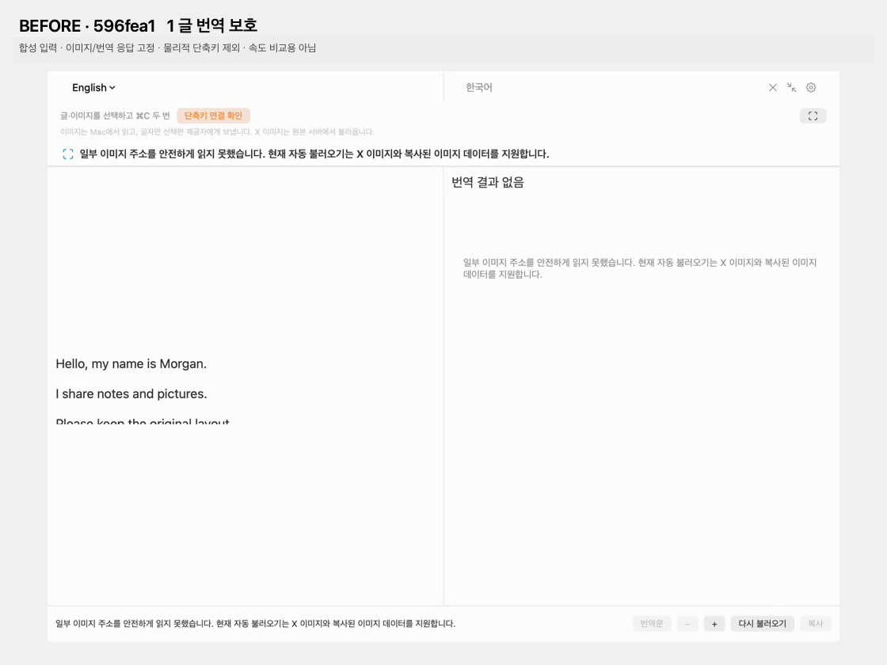
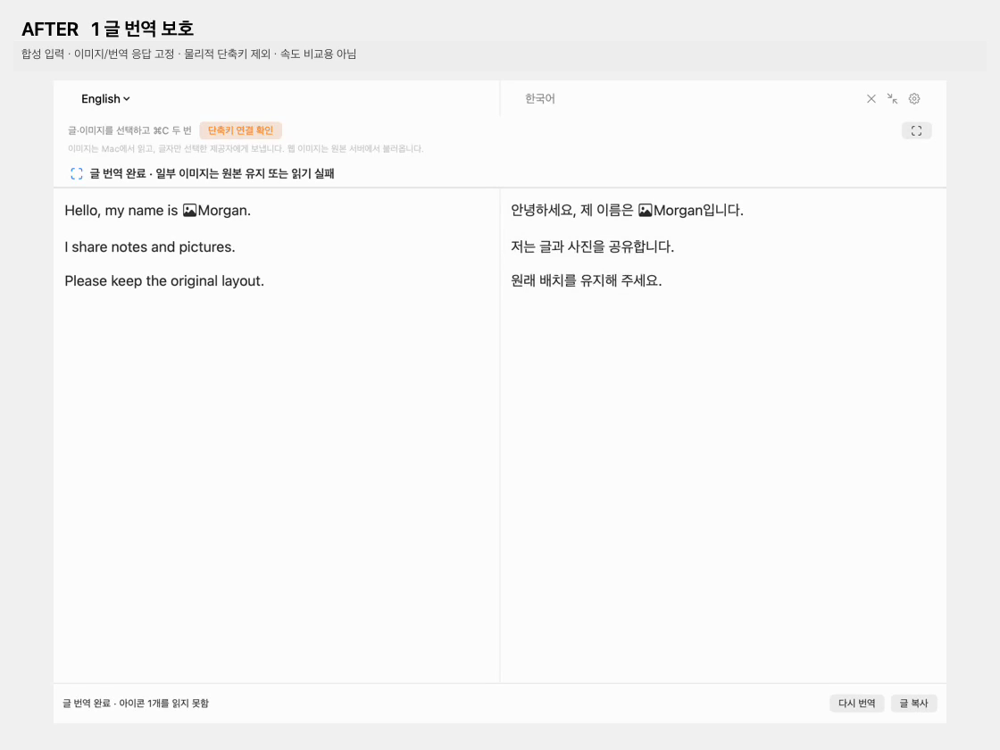

# 1~5 입력 실패 분리: 변경 전후 검증

이전 버전은 `596fea1`입니다. 선택 HTML에 미지원 이미지가 하나라도 있으면 전체 로드를 중단했고, OCR이 성공해야 선택 글을 번역했습니다. 수정본은 선택 글을 먼저 번역하고 이미지별 성공·실패를 표시합니다. 일반 앱의 기능 플래그는 켜지지 않습니다.

| 항목 | 이전 | 수정본 | 영상 |
| --- | --- | --- | --- |
| 1 글 번역 보호 | 작은 아이콘 주소가 거절되면 오른쪽 번역이 비어 있음 | 글 2블록 번역·복사 성공, 못 읽은 아이콘은18px 자리 표시 | [전후1](evidence/resilience/case-1-before-after.mp4) |
| 2 인라인 아이콘 | 18px 이미지를 큰 본문 이미지로 OCR·확대 | 표시18px 유지, OCR0개, 글 번역·복사 성공 | [전후2](evidence/resilience/case-2-before-after.mp4) |
| 3 개별 부분 처리 | 정상 이미지와 실패 이미지가 섞이면 전체 실패 | 정상 이미지5개 OCR 영역과 글2블록 반영, 실패 이미지1개 안내 | [전후3](evidence/resilience/case-3-before-after.mp4) |
| 4 주소 처리 | 상대 경로·X 외 주소를 거절 | 같은 HTML의 출처를 기준으로 상대 주소 해석, 관찰한 CDN 허용 | [전후4](evidence/resilience/case-4-before-after.mp4) |
| 5 부분 실패·복사 | 이미지가 실패하면 글 결과와 복사도 없음 | 글 번역·복사 성공, 이미지1개 실패를 별도로 표시 | [전후5](evidence/resilience/case-5-before-after.mp4) |

[전체 before](evidence/resilience/before.mp4) · [전체 after](evidence/resilience/after.mp4) · [after 상태 검사](evidence/resilience/after-checks.json)

영상은 각 버전의 실제 TranslationView를 같은 합성 입력으로 실행한 기록입니다. **이미지/번역 응답은 고정했고, 물리적 드래그·전역 ⌘C 두 번·실제 웹사이트 복사를 촬영한 영상은 아닙니다.** 준비된 응답의 재생 시간을 실제 모델 속도로 해석하지 않습니다. 비교 클립 끝에는 상태를 읽기 위한 정지 구간을 추가했습니다. 다른 앱 화면이나 사용자 첨부를 촬영·게시하지 않았습니다.

## 실제 제공자와 전송 경계

[실제 Codex 합성 영상](evidence/resilience/after-live-codex.mp4), [결과](evidence/resilience/live-checks.json), [stdio 감사](evidence/resilience/request-audit.json)를 별도로 제공합니다.

- 실제 `turn/start` **1회**, Codex·사용자 선택 `gpt-5.6-luna`. 실패하는18px 인라인 아이콘과 무관하게 선택 글2블록의 한국어 번역·독립 pasteboard 복사가 성공했습니다. OCR0개입니다.
- 승인된 합성 글자 블록만 입력됐고 이미지·원본 경로·주소·좌표·파일명·메타데이터는 추가되지 않았습니다. 일회성 스레드·승인 never·shell/view-image/apps/memory 도구 차단 검사도 통과했습니다.
- 프록시는 합성 영역과 글자 단위로 동일한 블록만 허용합니다. 글/이미지 단계 분할과 누락 재시도에 필요한 부분집합은 허용하되, 변경된 글·중복·미지 ID·추가 문장은 전송 전에 거절합니다.
- 이 검사는 앱→공식 CLI JSON-RPC 경계입니다. 제공자의 전체 HTTP·처리·보관 무저장을 뜻하지 않습니다.
- 별도 실제 HTTPS 검사에서 공개 저장소의 직접 만든 PNG를 non-X 호스트에서 메모리로 불러와1000×780 디코딩을 확인했습니다. 모델 호출이나 이미지 파일 저장은 없었습니다.

실제 요청은 테스트 전용 cold CLI·prewarm off 조건입니다. 첫 텍스트13.061초, 번역 호출12.927초로 기록됐으며 Fast 값은 결과 파일에 고정하지 않았습니다. 정상 앱의 warm 설정은 바꾸지 않았습니다. 동일 조건의 성공한 before 표본이 없어 **전체 속도 개선율은 미측정**입니다.

## 코드·UI 회귀와 빌드

- 최종 `scripts/image-translation-poc.sh --test` 통과: 디코딩/OCR·민감 클립보드·영역 매핑, Native 표시/배경·한국어 재OCR·채팅 배치, 스트리밍·확대 유지, 스캐너 좌표와 offscreen 드래그, 감사 프록시.
- 새 `InputResilienceTests`: 1~5, 인라인 위치·18px 크기, CSS 우선순위, 출처 HTML 일치·민감 표시, 잘못된 목적지 거절, 순수 글자 payload, 초기화 수명 검사.
- 표시 데이터만 검사하지 않고, 이미지→실패 입력 전환 뒤 실제 뷰를 재OCR해 원문·번역이 화면에 남는 것을 확인했습니다.
- 일반 `scripts/build.sh` 통과. `test-format-regressions.sh --strict` PASS36 / XFAIL0 / FAIL0 / XPASS0.
- 기존 전체 `test.sh` 결과는 초기596fea1의 기록입니다. 이번 추가 수정에서는 전체 프로그램을 재실행하지 않았고 POC 회귀·strict 포맷·일반 빌드를 실행했습니다. 변경은 POC 분기에 한정됩니다.
- 개발 중 새 파서의 HTML 루트 nil 부모 처리 오류와 네이티브 텍스트 뷰의 연속 입력 표시 문제를 발견·수정한 뒤 재검사했습니다. 빌드 도중 소스 변경으로 중단된 빌드도 최종 통과와 구분합니다. 최종 검증 뒤 생산 코드 지문은 [검사 입력](evidence/resilience/source-inputs.json)과 같습니다.

재현 명령: `scripts/replay-image-resilience.sh before`, `scripts/replay-image-resilience.sh after`. 둘 다 합성 입력·준비 응답을 쓰며 번역 요청은 없습니다.

## 콘텐츠 수명·미검증

사용자 원문·이미지·OCR·번역문을 운영자 서버·분석·진단·파일에 수집하는 기능을 추가하지 않았습니다. 입력과 처리 상태는 메모리에 두고 새 입력·닫기·종료 때 취소·정리합니다. 검증 산출물은 직접 만든 합성 자료만 포함합니다. 공식 CLI·제공자·OS의 보관은 별도 범위입니다.

전역 단축키 감시기를 시작하지 않는 촬영이므로 UI의 ‘단축키 연결 확인’은 실제 권한 실패 증거가 아닙니다. 원본 사용자 checkout·index·실행 바이너리·바탕화면 아이콘은 보존했습니다.

아직 확인하지 않은 것: 실제 Haein/X/Bluesky/GitHub/문서에서 물리적 드래그→⌘C 두 번→앱 완료, 모든 권한 상태, Claude의 새 경로 실제 응답, 모든 이미지 형식·장식 글꼴·복잡 배경·게임. 클립보드에 표시 크기나 출처가 없으면 아이콘 분류·상대 주소를 추측하지 않고 보수적으로 처리합니다. 전체 웹 DOM/폰트/배치 복원을 보장하지 않습니다.
