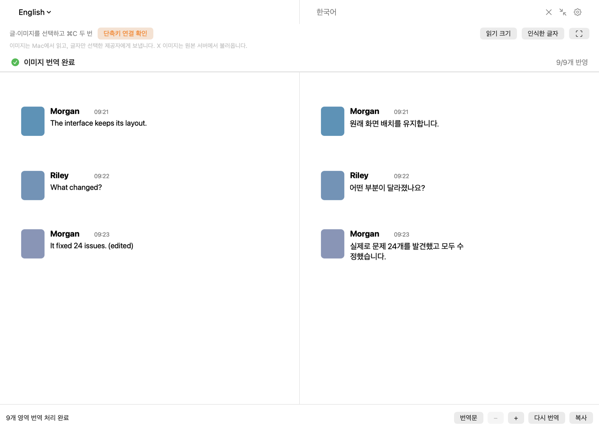

# 이미지 번역 POC 검증 범위

이 문서는 초기596fea1의 기록입니다. 이후의 실패 분리·인라인 아이콘·주소 처리와 전후 영상은 [새 검증 기록](RESILIENCE_VALIDATION.md)을 참고하세요.

이 PR은 기존 번역창에 이미지 입력을 연결하는 선택적 실험입니다. `DEEPK_IMAGE_TRANSLATION_POC` 플래그 없이 빌드하는 정식 앱에는 이미지 입력 UI·불러오기·OCR 경로가 포함되지 않습니다. 제공자 클라이언트에는 기본값이 `false`인 이미지 블록 프롬프트 옵션만 추가합니다.

기준은 `main`의 `c409674a6be322e5f522e62dd360d524bb618757`입니다. 별도 worktree에서 검사했으며 사용자가 테스트 중인 원래 checkout·앱·바탕화면 실행 아이콘은 변경하지 않았습니다.

## 현재 PR 소스의 오프라인 검사

검사 환경: macOS 26.6.2, arm64, Apple Swift 6.4. POC는 Swift 6 모드·경고 오류 처리·최적화 빌드이며, 일반 Xcode 빌드는 Debug입니다. 서로 다른 빌드의 시간을 속도 비교로 사용하지 않습니다.

검사한 코드와 최종 커밋의 코드가 같은지 확인한 뒤 게시했습니다. 문서·합성 산출물 추가 외에 검사 뒤 소스 변경은 없습니다. [실행 결과 메타데이터](evidence/current-checks.json)에 명령·종료 코드·소스 지문을 남겼습니다.

| 명령 | 실행 횟수 | 결과 |
| --- | --- | --- |
| `bash scripts/test.sh` | 전체 1회, 재실행 0회 | 통과. 스크립트가 직접 실행하는 Swift 프로그램 27개(포맷 포함)·Python 검사 2개. 포맷 PASS=36 / XFAIL=0 / FAIL=0 |
| `bash scripts/test-format-regressions.sh --strict` | 1회 | PASS=36 / XFAIL=0 / FAIL=0 / XPASS=0 |
| `bash scripts/build.sh` | 1회 | 일반 앱 Debug 빌드 통과, 앱 실행 없음 |
| `bash scripts/image-translation-poc.sh --test` | 빌드·검사 1회 | POC 검사 모드 4개·Python 감사 도우미 검사 통과. 모델 다운로드·제공자 요청 없음 |
| `bash -n` (POC 실행·모델 설치·로컬 런처) / `git diff --check` | 1회 이상 | 통과 |

위 프로그램 수는 개별 테스트 케이스나 단언문 수가 아닙니다. Python 검사의 내부 헬퍼 실행은 따로 세지 않았습니다. 이번 검사 실패·검사 재시도는 0회입니다. 실행 시간은 콜드 컴파일·동시 검사 부하를 포함하므로 제품 응답 속도로 해석하지 않습니다.

이미지 검사는 직접 만든 안내판, 2열 카드, 채팅 표본만 사용합니다.

- CSS `background-image` 복원, IMG 중복 제거, 선택 fragment·숨김 처리, 지원하지 않는 호스트·자격 증명·비HTTPS 거절
- PNG 디코딩, 로컬 Vision OCR, 민감·임시 표시가 있는 독립 pasteboard 거절
- 블록 ID·부분 응답·누락·중복 처리, 이미지 영역 우선 요청과 전체 응답 전 표시
- 배경·테두리·아바타 픽셀 보존, 이름·시간 분리, 본문 시작 위치와 긴 마지막 문장의 추가 줄, 한국어 재OCR
- 넘치는 번역의 원본 유지, 16pt 읽기 배율과 2배 확대 유지
- 화면 스캐너의 좌표 변환·화면 밖 모의 드래그 확정. 실제 화면 픽셀이나 권한은 사용하지 않음
- 감사 프록시의 버전 조회·프로세스 교체·불일치 요청 차단. 가짜 CLI만 사용

아래 화면은 **이 PR 실행 파일의 실제 `TranslationView`를 화면 밖에서 렌더링**한 것입니다. 준비된 합성 번역문·화면 맞춤 배율을 쓰며 전역 키·화면 캡처·제공자 요청 검증과 구별합니다. 이 검사는 감시기를 시작하지 않으므로 ‘단축키 연결 확인’이 표시됩니다.

## 이전 개발 실행의 실제 제공자 요청

[합성 시연 영상](evidence/development-synthetic-live-demo.mp4), [결과 메타데이터](evidence/development-live-checks.json), [요청 경계 검사](evidence/development-live-request-audit.json)는 PR 정리 전 개발본에서 실행한 기록입니다. 이 PR의 새 제공자 호출이나 현재 head 전체의 E2E 검사로 세지 않습니다. 현재 PR 준비 중 추가 실제 제공자 요청은 0회입니다.

직접 만든 채팅 이미지의 OCR 9개 영역과 선택 글 1개를 Codex에 한 번 요청했고 10개 블록을 연결했습니다. 번역창은 `TranslationPanel` 1개입니다. 전체 visible window 수에는 시스템 상태 막대 창 2개가 포함되어 3으로 기록되어 있습니다.

stdio JSON-RPC 검사에서는 입력이 텍스트 항목뿐이며, source가 합성 OCR·선택 글 배치와 정확히 같고 이미지 바이너리·이미지 주소·파일명·메타데이터가 추가되지 않았음을 확인했습니다. 일회성 스레드·도구 차단 설정도 확인했습니다. 이 검사는 앱→공식 CLI 경계이며, 제공자의 HTTP·보관·정책 전체를 감사한 결과가 아닙니다.

영상은 합성 입력을 자동 재생합니다. **사용자의 실제 마우스 드래그나 전역 ⌘C 두 번을 누른 영상이 아닙니다.** `shortcutMonitorReady=true`는 감시 연결 상태만 뜻합니다. 실제 X에서 IMG 태그가 0개인 복사 HTML의 CSS 이미지 주소 1개를 읽고 CDN에서 RAM으로 불러오는 별도 진단은 수행했지만, 그 사용자 콘텐츠는 제공자·영상·저장소에 넣지 않았습니다.

## 지연 해석

| 지표 | 변경 전(main) | 변경 후 | 차이·조건 |
| --- | --- | --- | --- |
| 이미지 입력·번역 | 해당 기능 없음 | 고정 합성 스트림에서 첫 이미지 0.891초, 전체 2.129초 | 1회·가짜 제공자. 기능 검증이며 모델 속도 비교가 아님 |
| 실제 제공자 첫 결과·최종 완료 개선율 | 비교값 없음 | 현재 PR에서 미측정 | 동일 모델·Fast·준비 상태의 전후 표본이 없어 개선율을 제시하지 않음 |
| 이전 개발본 Codex 1회 | 비교값 없음 | OCR 0.708초, 첫 초안 4.336초, 첫 이미지 4.375초, 번역 호출 5.925초 | 독립 측정 구간. 모델·Fast·준비 상태가 결과 JSON에 고정되어 있지 않아 재현 가능한 비교치가 아님 |

현재 경로는 AppModel의 기존 클라이언트를 재사용하고, 이미지 블록을 먼저 요청하며, 닫힌 블록부터 반영합니다. 불필요한 별도 웹뷰·PNG/base64 변환·콜드 클라이언트 실험은 제거했습니다. 이것이 전체 모델 응답을 몇 % 단축했다는 근거는 아직 없습니다.

위 로컬 스트림 결과의 [원본 수치](evidence/feedback-benchmark.json)에는 제공자 요청 0회, 전체 응답 전에 이미지 표시 `true`, 수동 2배 확대의 실제 비율 `2`가 기록되어 있습니다.

## 콘텐츠 비저장 검사와 미확인 부분

소스 검토 범위는 이미지 가져오기·Vision OCR·요청 생성·렌더링·창 닫기/입력 교체/종료 정리, 테스트 산출물 분기입니다. 일반 입력에 대한 콘텐츠 로그·보고서·스크린샷·이미지 임시파일 쓰기·운영자 서버/분석 전송을 추가하지 않았습니다. 외부 이미지 다운로드는 캐시·쿠키·자격 증명 저장소가 없는 메모리 세션이며, 이미지 원본 서버에는 GET 요청이 전달됩니다.

화면과 작업에 필요한 상태는 메모리에 두고 닫기·교체·종료 때 취소·참조 정리합니다. 테스트 산출물은 명시적으로 실행한 합성 자료만 포함합니다. 입력 이미지의 지시문은 번역 데이터로 취급하며 기존 CLI 도구 차단·환경 제한을 유지합니다.

다음은 확인하지 않았습니다.

- 현재 PR head의 실제 X 드래그→전역 ⌘C 두 번→제공자까지의 자동 E2E와 모든 macOS 권한 상태
- Claude 이미지 블록의 실제 제공자 응답, 모든 X 페이지·다른 브라우저·다른 사이트
- 게임·전체 화면·다중 Space, 복잡한 배경·장식 글꼴·외곽선, 선택적 MI-GAN 모델의 이번 worktree 실행
- 모든 레이아웃·긴 번역·다언어 OCR의 품질. POC OCR 언어는 한국어·영어 중심
- 글자가 없는 사진은 OCR 안내로 멈추며, 그 요청에 함께 선택한 글만 자동으로 번역하는 처리는 아직 없음
- 공식 CLI·제공자·운영체제 자체의 보관. 전체 경로의 무저장이나 메모리의 보안 소거는 약속하지 않음

원본 서버에서 이미지를 읽을 수 없는 경우와 레이아웃·복원이 안전하지 않은 영역은 실패/원본 유지 사유를 표시합니다. 완전한 웹 DOM 배치 복원이나 실시간 화면 감시 기능은 포함하지 않습니다.
