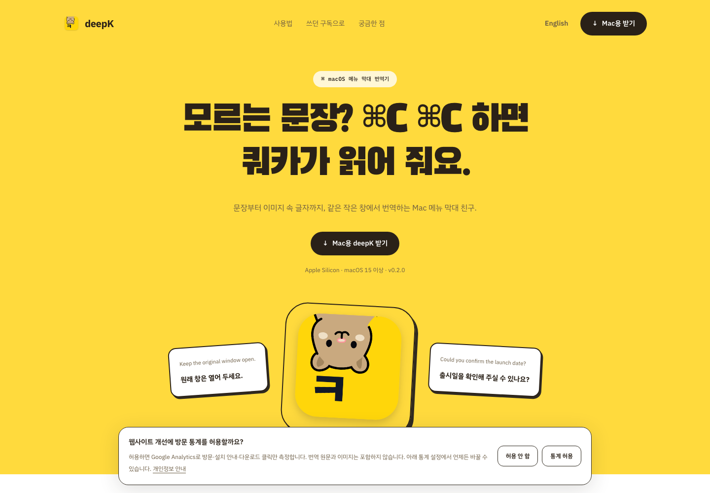
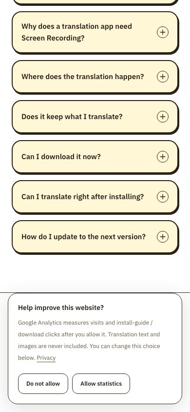
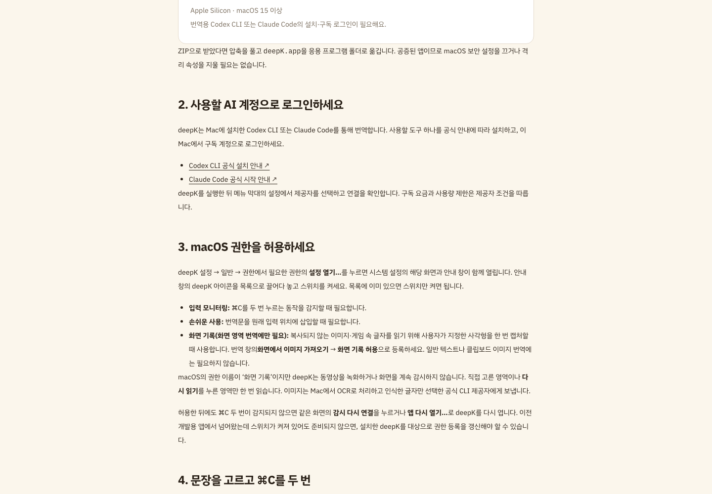

# SEO·웹 방문 통계 검증 (2026-11-07)

실제 사용자 콘텐츠 없이 공개 페이지와 직접 만든 합성 URL만 검사했다. Node 24.14.1, pnpm 12.15.0, Playwright 1.58.2 환경이다. 키보드·일반 클립보드·Mac 앱·실제 번역 제공자를 사용하지 않았다. 설치 명령 복사는 격리된 테스트 브라우저에서 Clipboard API를 대체해 검사했으며 시스템 클립보드를 바꾸지 않았다.

## 최종 소스 검사

- `pnpm test`: 20개 테스트 통과. 기존 6개와 방문 경로·허용 이벤트·동의·철회·쿠키·저장소·탭 간 변경·사이트맵의 14개 회귀 검사다.
- `pnpm check`: 오류·경고·힌트 0개.
- `pnpm format:check`, `pnpm build`, `git diff --check`: 통과. 정적 HTML 26개와 robots·sitemap을 생성했다.
- 공식 한영 6개 페이지의 canonical, 세 언어 대체 링크(ko/en/x-default), JSON-LD를 확인했다. 시안과 편집 가능한 체험은 noindex를 유지하며 사이트맵에서 제외했다.

## 실제 Google 태그를 사용한 브라우저 검사

검증할 빌드 결과를 격리된 브라우저에서 공식 origin으로 매핑했다. 앱·Google SDK는 실제 코드이며, 페이지 조회와 클릭은 합성 검증이다. 실제 운영 방문자 수를 나타내지 않는다.

| 사례 | 결과 |
| --- | --- |
| 허용 전 | Google Analytics·Tag Manager 요청 0건 |
| 거절 후 | 요청 0건 |
| 허용 후 | page_view, install_guide_open, install_command_copy, download_click 전송 및 Google HTTP 204 확인 |
| URL 내용 제거 | 쿼리·해시·유입 경로에 넣은 합성 문자열이 실제 Google 요청에 없음 |
| 내부 이동 | GitHub 유입 후 설치 안내로 이동해도 소스 github 유지 |
| 철회 후 | 추가 요청 0건, deepK 전용 GA 쿠키 제거 |
| 화면 기록 설명 | 설치 안내에 캡처 목적·일회성 동작·로컬 OCR·텍스트 전송 경계 표시 |
| 영어 모바일 | 390px에서 허용/거절 표시, 가로 넘침 없음 |
| DNT·GPC | 각각 요청 0건 |

표의 URL 내용 제거는 허용 후 검사에 포함해 브라우저 실행은 총 9개 시나리오로 기록했다. 원본 Google 요청에는 합성 데이터만 있으며 공개 저장소에는 요청 원본을 넣지 않았다. HTTP 204는 측정 서버 응답 근거이고, GA4 보고서 반영이나 검색 색인 완료를 뜻하지 않는다.

개발 중 단위 테스트 하네스의 VM 배열 비교, 브라우저 하네스의 URL 필드 접근·이벤트 배치 대기, 외부 글꼴의 networkidle 시간 초과를 수정해 재실행했다. 마지막 브라우저 실행은 9개 시나리오 전체 통과했다. 발견한 실제 코드 문제인 내부 페이지의 유입 재분류도 고치고 회귀 검사와 실제 요청으로 확인했다.

## 실제 화면

스크린샷은 위 정적 빌드를 실제 브라우저에서 실행한 화면이다. 계정·사용자 번역·사용자 이미지는 포함하지 않는다.

## 측정 한계

운영 배포 후 추가 검사에서 목적지 `config`에만 쿠키 옵션을 넘기면 기본 `_ga` 이름이 사용되는 것을 발견했다. 앞선 쿠키 검사는 전용 이름의 부재만 확인해 이 문제를 잡지 못했다. 쿠키 옵션을 태그 초기화 전 전역 `set`에도 적용하고, 실제 전용 쿠키가 **생성된 뒤** 철회하면 삭제되는지 다시 확인했다. 최신 쿠키 검증은 아래 결과를 기준으로 한다.

- 실제 SDK가 `deepk_ga`, `deepk_ga_3MXXKZ9JLX`를 `.deepk.geuni.me`에 생성한 것을 확인했다.
- 허용 전 요청 0건, 허용 후 Google HTTP 204, 철회 후 추가 요청 0건·전용 쿠키 0개를 확인했다.
- 이전 설정에서 만든 deepK 측정 ID의 세션 쿠키만 정리하고, 합성으로 넣은 개인 블로그의 공용 `_ga`는 값과 함께 유지했다. 공용 루트 쿠키는 삭제하지 않는다.
- 단위 테스트에도 실제 쿠키 이름과 전역 옵션, 기존 전용 세션의 정리·다른 쿠키 보존 검사를 반영했다. 20개 전체 테스트가 다시 통과했다.

운영 환경변수에 stdin의 마지막 줄바꿈이 포함되어 첫 배포의 측정 UI가 비활성화된 문제도 설정값을 개행 없이 갱신해 해결했다. 새 운영 응답에서 측정 ID와 정확한 소유권 메타태그 값을 확인했다. 이는 로컬 빌드 성공과 실제 배포 검증을 분리해 발견한 문제다.

- 다운로드 클릭·명령 복사는 설치 성공이나 앱 사용의 증거가 아니다.
- 동의 거절·추적 차단으로 방문 수가 누락될 수 있다.
- 검색 순위·색인·실제 방문자의 행동 변화·LCP/INP 전후 비교는 미측정이다.
- Mac 앱의 소스·의존성·릴리스 산출물은 이 변경에서 수정하지 않았다. 웹 전용 변경이므로 앱 전체 테스트와 앱 재배포는 반복하지 않았다.
